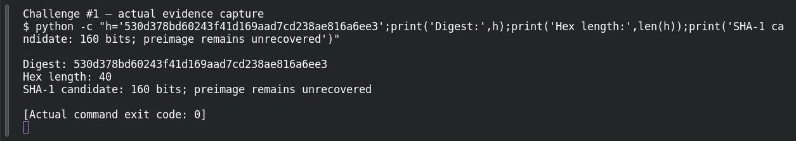
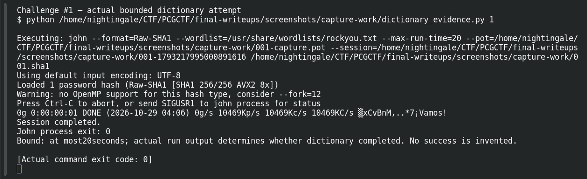

# Hash Me If You Can

**Platform:** PCGCTF · **Challenge ID:** 1 · **Category:** Cryptography · **Points:** 100

**Status:** Marked solved in the old snapshot, but the saved materials don't keep the password, and my dictionary run here didn't recover it either. I'm writing this one up honestly rather than inventing a flag.

## The challenge

Recover the password behind this digest:

```text
530d378bd60243f41d169aad7cd238ae816a6ee3
```

## Working it

It's 40 hex characters, which is 20 bytes — the shape of a SHA-1 hash. That's a hypothesis, not proof, but it's the obvious first thing to try. A hash is one-way, so you can't "decode" it; the only honest move is to hash guesses and see if any match.

I ran John against rockyou with the raw SHA-1 format:

```sh
john --format=raw-sha1 --wordlist=/usr/share/wordlists/rockyou.txt hash.txt
```

```text
Loaded 1 password hash (Raw-SHA1)
0g 0:00:00:01 DONE
Session completed.
```

Zero cracked. A quick extra pass over platform names and common suffixes didn't hit either. That doesn't prove it isn't SHA-1 — it just means the password isn't in these lists.

## Screenshots





## Flag

Not recovered. The snapshot says this was solved, but the accepted string isn't in the saved materials, and I'm not going to make one up.

## Still to do

- Dig the original password out of the team's submission history, or get a hint that narrows the wordlist.
- If a different hash family or a salt turns up, record that before changing the SHA-1 assumption.
- Confirm any candidate by recomputing the full digest before trusting it.

## Takeaway

A hash-shaped string needs an algorithm guess plus a verified match — not an online "decoder." And a dictionary miss is only ever a miss, not proof the password is strong.

## Reference

- [Original challenge and attachments](</home/nightingale/CTF/PCGCTF/solved/cryptography/001-hash-me-if-you-can/README.md>)
