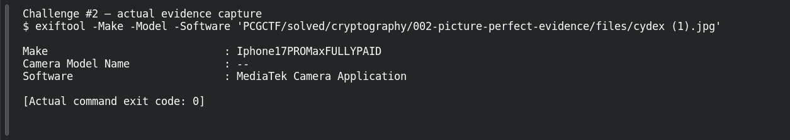
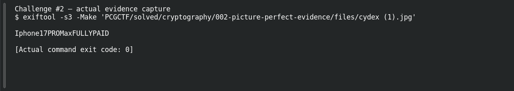

# Picture Perfect Evidence

**Platform:** PCGCTF · **Challenge ID:** 2 · **Category:** Cryptography · **Points:** 100

**Difficulty:** Not recorded in the available platform metadata.

**Verification status:** Verified — solved in the last PCGCTF snapshot. Local evidence independently reproduced; exact historical platform submission is not newly tested.

## Challenge and objective

Read the camera make hidden in the supplied JPEG metadata; the picture’s visible subject is not the requested answer.

Original description: [saved challenge description](</home/nightingale/CTF/PCGCTF/solved/cryptography/002-picture-perfect-evidence/README.md>). Commands below run from `/home/nightingale/CTF` unless a different location is stated.

## Initial analysis

The description asks about the device used to create the image, so EXIF metadata is the natural starting point. Camera “Make” and “Model” are separate fields. This file contains many plausible-looking camera and software attributes; the answer comes from the named Make field, even though its value appears deliberately edited.

## Step-by-step solution

### 1. Read the metadata

ExifTool understands JPEG EXIF tags. Restricting the output to three fields makes the requested Make easy to distinguish from the model and camera software. Quoting the path preserves the spaces and parentheses in the filename.

```sh
exiftool -Make -Model -Software 'PCGCTF/solved/cryptography/002-picture-perfect-evidence/files/cydex (1).jpg'
```

**Recorded output / observation:**

```text
Make : Iphone17PROMaxFULLYPAID
Camera Model Name : --
Software : MediaTek Camera Application
```

The exact Make string is `Iphone17PROMaxFULLYPAID`. The surrounding metadata is inconsistent with treating that string as a verified real-world camera identification; it is the value planted for this challenge.

### 2. Preserve the decisive field

`-s3` prints the tag value without its label, giving a clean string for comparison with the requested wrapper. This command is a reproducible focused version of the full metadata dump saved during drafting.

```sh
exiftool -s3 -Make 'PCGCTF/solved/cryptography/002-picture-perfect-evidence/files/cydex (1).jpg'
```

**Recorded output / observation:**

```text
Iphone17PROMaxFULLYPAID
```

Use this exact capitalization rather than normalizing it to a conventional brand name.

## Captured screenshots and evidence

Captured on 2026-10-29 from actual terminal sessions or browser views. Captions distinguish new results, preserved records, source images and blockers. No platform acceptance is inferred from these images.

### Challenge #2 — actual evidence capture



Fresh execution of the documented offline step.

Command/action actually executed:

```sh
exiftool -Make -Model -Software 'PCGCTF/solved/cryptography/002-picture-perfect-evidence/files/cydex (1).jpg'
```

[Actual command transcript](../screenshots/capture-work/002-step-1.terminal.log) · [Execution record](../screenshots/capture-work/002-step-1.result.json). Notice the result fields discussed in the corresponding solution step; the transcript retains lines that extend beyond the screenshot viewport.

### Challenge #2 — actual evidence capture



Fresh execution of the documented offline step.

Command/action actually executed:

```sh
exiftool -s3 -Make 'PCGCTF/solved/cryptography/002-picture-perfect-evidence/files/cydex (1).jpg'
```

[Actual command transcript](../screenshots/capture-work/002-step-2.terminal.log) · [Execution record](../screenshots/capture-work/002-step-2.result.json). Notice the result fields discussed in the corresponding solution step; the transcript retains lines that extend beyond the screenshot viewport.

## Flag discovery and verification

Saved result / candidate:

```text
pcgCTF{Iphone17PROMaxFULLYPAID}
```

Local evidence independently reproduced; exact historical platform submission is not newly tested.

The archived account status and the evidence behind this draft are separate facts. No new PCGCTF acceptance is claimed. Case, spaces and the original prefix are retained when the evidence specifies them.

## Remaining review tasks

- The available command results are captured below. Preserve a real acceptance record if a later platform verification is performed.

## What this challenge taught me

Metadata can be the challenge payload, and it can be edited. Read the specific requested tag instead of inferring the device from unrelated fields.

## Evidence and attribution

- [Original challenge and attachments](</home/nightingale/CTF/PCGCTF/solved/cryptography/002-picture-perfect-evidence/README.md>)
- [002-exif.txt](</home/nightingale/CTF/PCGCTF/final-writeups/evidence-solved/002-exif.txt>)
