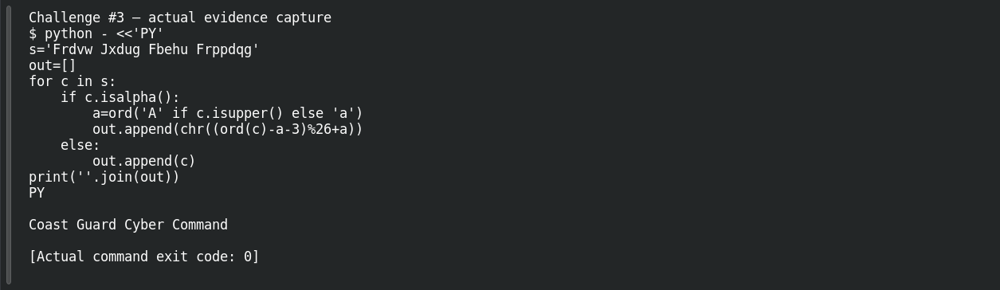

# Ancient Message

**Platform:** PCGCTF · **Challenge ID:** 3 · **Category:** Cryptography · **Points:** 100

**Status:** Solved in the last snapshot; decode reproduced locally.

## The challenge

Decrypt `Frdvw Jxdug Fbehu Frppdqg`. The description hands us the method: a Caesar cipher with a shift of three.

## Solving it

Caesar just shifts every letter by a fixed amount, so decrypting is shifting back three. A quick Python snippet does it while leaving the spaces and capitals alone:

```sh
python3 -c "import codecs; print(''.join(chr((ord(c)-ord('A' if c.isupper() else 'a')-3)%26+ord('A' if c.isupper() else 'a')) if c.isalpha() else c for c in 'Frdvw Jxdug Fbehu Frppdqg'))"
```

```text
Coast Guard Cyber Command
```

Every word comes out readable, which confirms the shift direction. (You could also do this with `tr 'A-Za-z' 'X-ZA-Wx-za-w'` if you prefer.)

## Screenshot



## Flag

```text
pcgCTF{Coast Guard Cyber Command}
```

The challenge doesn't say to swap spaces for underscores, so I kept the spaces.

## Takeaway

A given Caesar shift is a rule, not a password — preserve case and punctuation and the plaintext falls right out.

## References

- [Original challenge and attachments](</home/nightingale/CTF/PCGCTF/solved/cryptography/003-ancient-message/README.md>)
