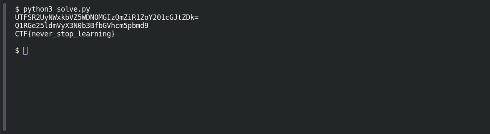

# Encoded Secret

**Platform:** PCGCTF · **Challenge ID:** 4 · **Category:** Cryptography · **Points:** 100

**Status:** Solved in the last snapshot; decode reproduced locally.

## The challenge

Decode an intercepted Base64 string. The "once is enough?" hint is a tell that it's nested.

## Solving it

Each decoded string is another Base64 input until the third pass produces the flag. The following snippet prints all three stages:

Save the following as `solve.py` then run `python3 solve.py`. [Download the script](../scripts/004-solve.py).

```python
import base64

value = b"VVRGU1IyVXlOV3hrYlZaNVdETk9NR0l6UW1aaVIxWm9ZMjAxY0dKdFpEaz0="
for _ in range(3):
    value = base64.b64decode(value)
    print(value.decode())
```

```text
UTFSR2UyNWxkbVZ5WDNOMGIzQmZiR1ZoY201cGJtZDk=
Q1RGe25ldmVyX3N0b3BfbGVhcm5pbmd9
CTF{never_stop_learning}
```

The third result is a readable flag, so the decoding stops there. A decoder error is not needed to establish the result.

## Screenshot

Fresh local reproduction using the command described above.



## Flag

```text
CTF{never_stop_learning}
```

The decoded prefix is `CTF`, and this challenge's saved description doesn't record a `pcgCTF` wrapper, so I left the raw result rather than normalizing it.

## Takeaway

Inspect the result after each layer so the next decoding step follows from the data.

## References

- [Original challenge and attachments](</home/nightingale/CTF/PCGCTF/solved/cryptography/004-encoded-secret/README.md>)
