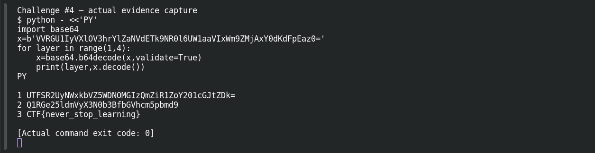

# Encoded Secret

**Platform:** PCGCTF · **Challenge ID:** 4 · **Category:** Cryptography · **Points:** 100

**Difficulty:** Not recorded in the available platform metadata.

**Verification status:** Verified — solved in the last PCGCTF snapshot. Local evidence independently reproduced; exact historical platform submission is not newly tested.

## Challenge and objective

Decode the intercepted Base64 text through all its actual encoding layers.

Original description: [saved challenge description](</home/nightingale/CTF/PCGCTF/solved/cryptography/004-encoded-secret/README.md>). Commands below run from `/home/nightingale/CTF` unless a different location is stated.

## Initial analysis

Base64 changes a byte sequence into printable characters; it is not encryption. The prompt’s “once is enough?” clue suggests nesting. After each decode, inspect the output rather than blindly continuing until an arbitrary number of iterations has elapsed.

## Step-by-step solution

### 1. Decode one layer at a time

`validate=True` rejects characters outside the Base64 alphabet instead of silently dropping them. The first two results remain valid Base64 strings; the third is a flag-shaped message. The three iterations are justified by the observed outputs.

```sh
python - <<'PY'
import base64
x=b'VVRGU1IyVXlOV3hrYlZaNVdETk9NR0l6UW1aaVIxWm9ZMjAxY0dKdFpEaz0='
for layer in range(1,4):
    x=base64.b64decode(x,validate=True)
    print(layer,x.decode())
PY
```

**Recorded output / observation:**

```text
1 UTFSR2UyNWxkbVZ5WDNOMGIzQmZiR1ZoY201cGJtZDk=
2 Q1RGe25ldmVyX3N0b3BfbGVhcm5pbmd9
3 CTF{never_stop_learning}
```

The third layer is the recovered source flag. A further strict decode fails because the braces are not Base64 characters; that failure is a sensible stopping signal, not a missing cryptographic key.

## Captured screenshots and evidence

Captured on 2026-10-29 from actual terminal sessions or browser views. Captions distinguish new results, preserved records, source images and blockers. No platform acceptance is inferred from these images.

### Challenge #4 — actual evidence capture



Fresh execution of the documented offline step.

Command/action actually executed:

```sh
python - <<'PY'
import base64
x=b'VVRGU1IyVXlOV3hrYlZaNVdETk9NR0l6UW1aaVIxWm9ZMjAxY0dKdFpEaz0='
for layer in range(1,4):
    x=base64.b64decode(x,validate=True)
    print(layer,x.decode())
PY
```

[Actual command transcript](../screenshots/capture-work/004-step-1.terminal.log) · [Execution record](../screenshots/capture-work/004-step-1.result.json). Notice the result fields discussed in the corresponding solution step; the transcript retains lines that extend beyond the screenshot viewport.

## Flag discovery and verification

Saved result / candidate:

```text
CTF{never_stop_learning}
```

Local evidence independently reproduced; exact historical platform submission is not newly tested.

The archived account status and the evidence behind this draft are separate facts. No new PCGCTF acceptance is claimed. Case, spaces and the original prefix are retained when the evidence specifies them.

The raw decoded prefix is `CTF`, and this particular saved description does not record a replacement wrapper. Preserve the raw result; consult the original accepted submission before claiming a `pcgCTF`-normalized string was accepted.

## Remaining review tasks

- The available command results are captured below. Preserve a real acceptance record if a later platform verification is performed.

## What this challenge taught me

Encoding layers can be recognized from their output alphabet, and a structured result tells us when to stop. Do not confuse more decoding with more certainty.

## Evidence and attribution

- [Original challenge and attachments](</home/nightingale/CTF/PCGCTF/solved/cryptography/004-encoded-secret/README.md>)
