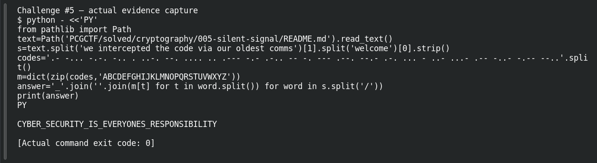

# Silent Signal

**Platform:** PCGCTF · **Challenge ID:** 5 · **Category:** Cryptography · **Points:** 100

**Difficulty:** Not recorded in the available platform metadata.

**Verification status:** Verified — solved in the last PCGCTF snapshot. Local evidence independently reproduced; exact historical platform submission is not newly tested.

## Challenge and objective

Translate the Morse groups into words and use underscores where the challenge explicitly requires spaces to be replaced.

Original description: [saved challenge description](</home/nightingale/CTF/PCGCTF/solved/cryptography/005-silent-signal/README.md>). Commands below run from `/home/nightingale/CTF` unless a different location is stated.

## Initial analysis

Dots, dashes, inter-letter spaces and slash-separated words make the encoding identifiable before any tool is needed. The task’s important formatting instruction is “space should be _”; that instruction applies after decoding, not to the Morse groups themselves.

## Step-by-step solution

### 1. Translate the Morse alphabet

The mapping associates Morse groups with letters. Splitting first on `/` preserves word boundaries; splitting each word on whitespace yields individual letters. Joining decoded words with `_` follows the recorded instruction rather than guessing a flag convention.

```sh
python - <<'PY'
from pathlib import Path
text=Path('PCGCTF/solved/cryptography/005-silent-signal/README.md').read_text()
s=text.split('we intercepted the code via our oldest comms')[1].split('welcome')[0].strip()
codes='.- -... -.-. -.. . ..-. --. .... .. .--- -.- .-.. -- -. --- .--. --.- .-. ... - ..- ...- .-- -..- -.-- --..'.split()
m=dict(zip(codes,'ABCDEFGHIJKLMNOPQRSTUVWXYZ'))
answer='_'.join(''.join(m[t] for t in word.split()) for word in s.split('/'))
print(answer)
PY
```

**Recorded output / observation:**

```text
CYBER_SECURITY_IS_EVERYONES_RESPONSIBILITY
```

The plaintext is grammatical and all groups decode with the same alphabet. The exact underscores and uppercase letters are retained in the saved flag.

## Captured screenshots and evidence

Captured on 2026-10-29 from actual terminal sessions or browser views. Captions distinguish new results, preserved records, source images and blockers. No platform acceptance is inferred from these images.

### Challenge #5 — actual evidence capture



Fresh execution of the documented offline step.

Command/action actually executed:

```sh
python - <<'PY'
from pathlib import Path
text=Path('PCGCTF/solved/cryptography/005-silent-signal/README.md').read_text()
s=text.split('we intercepted the code via our oldest comms')[1].split('welcome')[0].strip()
codes='.- -... -.-. -.. . ..-. --. .... .. .--- -.- .-.. -- -. --- .--. --.- .-. ... - ..- ...- .-- -..- -.-- --..'.split()
m=dict(zip(codes,'ABCDEFGHIJKLMNOPQRSTUVWXYZ'))
answer='_'.join(''.join(m[t] for t in word.split()) for word in s.split('/'))
print(answer)
PY
```

[Actual command transcript](../screenshots/capture-work/005-step-1.terminal.log) · [Execution record](../screenshots/capture-work/005-step-1.result.json). Notice the result fields discussed in the corresponding solution step; the transcript retains lines that extend beyond the screenshot viewport.

## Flag discovery and verification

Saved result / candidate:

```text
pcgCTF{CYBER_SECURITY_IS_EVERYONES_RESPONSIBILITY}
```

Local evidence independently reproduced; exact historical platform submission is not newly tested.

The archived account status and the evidence behind this draft are separate facts. No new PCGCTF acceptance is claimed. Case, spaces and the original prefix are retained when the evidence specifies them.

## Remaining review tasks

- The available command results are captured below. Preserve a real acceptance record if a later platform verification is performed.

## What this challenge taught me

Separators are part of the evidence. Decode the message first, then apply only the formatting conversion that the challenge actually specifies.

## Evidence and attribution

- [Original challenge and attachments](</home/nightingale/CTF/PCGCTF/solved/cryptography/005-silent-signal/README.md>)
- [Earlier solution / teammate provenance](</home/nightingale/CTF/PCGCTF/solved/cryptography/005-silent-signal/solution.md>)
- [independent-checks.json](</home/nightingale/CTF/PCGCTF/team-writeups/garcia-day1/independent-checks.json>)
