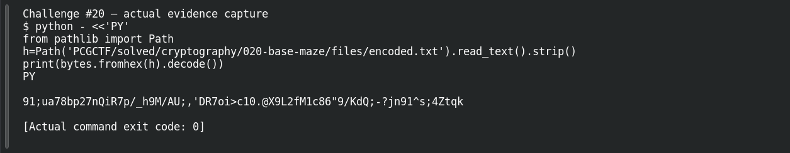
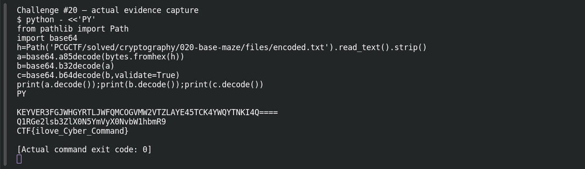

# Base Maze

**Platform:** PCGCTF · **Challenge ID:** 20 · **Category:** Cryptography · **Points:** 250

**Status:** Solved in the last snapshot; decode reproduced locally.

## The challenge

Peel a message back through hex, Ascii85, Base32 and Base64.

## Solving it

The outer string is all hex digits with an even length, so the first move is hex → bytes. The result is punctuation-heavy text that isn't hex anymore — its character set looks like Ascii85. From there the next output has Base32's uppercase alphabet and `=` padding, then a final Base64 layer. Each step is driven by what the previous one looks like, not by the title:

```sh
python3 -c "
import base64
h=open('encoded.txt').read().strip()
a=base64.a85decode(bytes.fromhex(h))
b=base64.b32decode(a)
print(a.decode()); print(b.decode()); print(base64.b64decode(b).decode())"
```

```text
KEYVER3FGJWHGYRTLJWFQMCOGVMW2VTZLAYE45TCK4YWQYTNKI4Q====
Q1RGe2lsb3ZlX0N5YmVyX0NvbW1hbmR9
CTF{ilove_Cyber_Command}
```

The source flag is prefixed `CTF`; the challenge uses `pcgCTF`, so keep the payload `ilove_Cyber_Command` exactly when wrapping it.

## Screenshots





## Flag

```text
pcgCTF{ilove_Cyber_Command}
```

## Takeaway

Stacked encodings are still just reversible representation, not protection. Printing every intermediate string keeps the chain auditable and flags a wrong decoder immediately.

## References

- [Original challenge and attachments](</home/nightingale/CTF/PCGCTF/solved/cryptography/020-base-maze/README.md>)
- [Earlier solution / teammate provenance](</home/nightingale/CTF/PCGCTF/solved/cryptography/020-base-maze/solution.md>)
