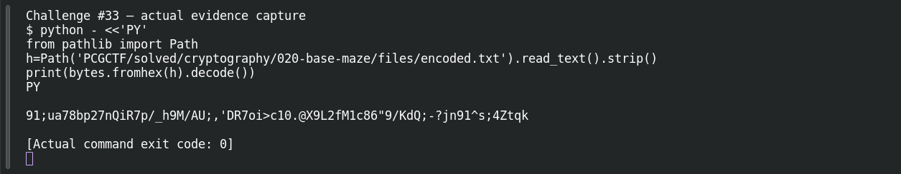
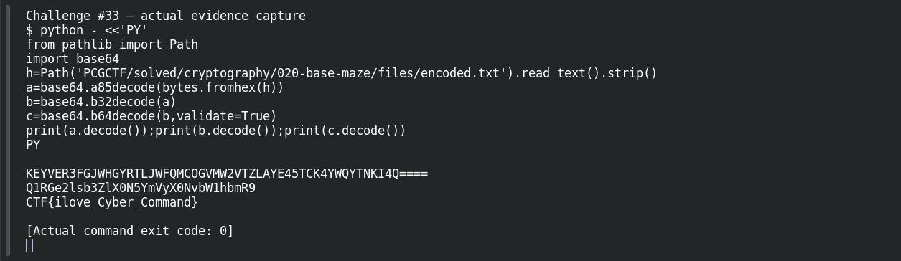

# Multi-Base Layers

**Platform:** PCGCTF · **Challenge ID:** 33 · **Category:** Cryptography · **Points:** 100

**Difficulty:** Not recorded in the available platform metadata.

**Verification status:** Verified — solved in the last PCGCTF snapshot. Local evidence independently reproduced; exact historical platform submission is not newly tested.

## Challenge and objective

Recover the original message hidden behind hex, Ascii85, Base32 and Base64 encodings.

Original description: [saved challenge description](</home/nightingale/CTF/PCGCTF/solved/cryptography/033-multi-base-layers/README.md>). Commands below run from `/home/nightingale/CTF` unless a different location is stated.

## Initial analysis

The outer string contains only hexadecimal digits and has an even length, so converting pairs of hex digits into bytes is a strong first hypothesis. The resulting punctuation-heavy text is not another hex string. Its character set suggests Ascii85; subsequent outputs have the padding and alphabet of Base32 and then Base64. The method is driven by each intermediate result rather than by the title alone.

## Step-by-step solution

### 1. Inspect and decode the hex layer

`bytes.fromhex` converts each pair of hex digits to one byte. UTF-8 decoding is safe here because the resulting bytes are printable ASCII. Challenge #33 embeds the identical hex string in its description; using #20’s identical artifact avoids retyping it.

```sh
python - <<'PY'
from pathlib import Path
h=Path('PCGCTF/solved/cryptography/020-base-maze/files/encoded.txt').read_text().strip()
print(bytes.fromhex(h).decode())
PY
```

**Recorded output / observation:**

```text
91;ua78bp27nQiR7p/_h9M/AU;,'DR7oi>c10.@X9L2fM1c86"9/KdQ;-?jn91^s;4Ztqk
```

The broad punctuation alphabet fits Ascii85 better than Base64; the next decoder must match that alphabet.

### 2. Finish the observed encoding chain

Ascii85 expands printable groups back to bytes. Base32 then accepts the uppercase alphanumeric string with trailing `=` padding. The final Base64 decode produces a structured message. These are deterministic inverse encodings; no guessed key or password enters the procedure.

```sh
python - <<'PY'
from pathlib import Path
import base64
h=Path('PCGCTF/solved/cryptography/020-base-maze/files/encoded.txt').read_text().strip()
a=base64.a85decode(bytes.fromhex(h))
b=base64.b32decode(a)
c=base64.b64decode(b,validate=True)
print(a.decode());print(b.decode());print(c.decode())
PY
```

**Recorded output / observation:**

```text
KEYVER3FGJWHGYRTLJWFQMCOGVMW2VTZLAYE45TCK4YWQYTNKI4Q====
Q1RGe2lsb3ZlX0N5YmVyX0NvbW1hbmR9
CTF{ilove_Cyber_Command}
```

The source text has a `CTF` prefix, while the challenge specifies `pcgCTF`. Preserve the payload `ilove_Cyber_Command` exactly when applying that explicit wrapper.

## Captured screenshots and evidence

Captured on 2026-10-29 from actual terminal sessions or browser views. Captions distinguish new results, preserved records, source images and blockers. No platform acceptance is inferred from these images.

### Challenge #33 — actual evidence capture



Fresh execution of the documented offline step.

Command/action actually executed:

```sh
python - <<'PY'
from pathlib import Path
h=Path('PCGCTF/solved/cryptography/020-base-maze/files/encoded.txt').read_text().strip()
print(bytes.fromhex(h).decode())
PY
```

[Actual command transcript](../screenshots/capture-work/033-step-1.terminal.log) · [Execution record](../screenshots/capture-work/033-step-1.result.json). Notice the result fields discussed in the corresponding solution step; the transcript retains lines that extend beyond the screenshot viewport.

### Challenge #33 — actual evidence capture



Fresh execution of the documented offline step.

Command/action actually executed:

```sh
python - <<'PY'
from pathlib import Path
import base64
h=Path('PCGCTF/solved/cryptography/020-base-maze/files/encoded.txt').read_text().strip()
a=base64.a85decode(bytes.fromhex(h))
b=base64.b32decode(a)
c=base64.b64decode(b,validate=True)
print(a.decode());print(b.decode());print(c.decode())
PY
```

[Actual command transcript](../screenshots/capture-work/033-step-2.terminal.log) · [Execution record](../screenshots/capture-work/033-step-2.result.json). Notice the result fields discussed in the corresponding solution step; the transcript retains lines that extend beyond the screenshot viewport.

## Flag discovery and verification

Saved result / candidate:

```text
pcgCTF{ilove_Cyber_Command}
```

Local evidence independently reproduced; exact historical platform submission is not newly tested.

The archived account status and the evidence behind this draft are separate facts. No new PCGCTF acceptance is claimed. Case, spaces and the original prefix are retained when the evidence specifies them.

## Remaining review tasks

- The available command results are captured below. Preserve a real acceptance record if a later platform verification is performed.

## What this challenge taught me

Layered encoding is still reversible representation, not cryptographic protection. Recording every intermediate string makes a multi-layer solution auditable and exposes a wrong decoder immediately.

## Evidence and attribution

- [Original challenge and attachments](</home/nightingale/CTF/PCGCTF/solved/cryptography/033-multi-base-layers/README.md>)
- [Earlier solution / teammate provenance](</home/nightingale/CTF/PCGCTF/solved/cryptography/033-multi-base-layers/solution.md>)
- [independent-checks.json](</home/nightingale/CTF/PCGCTF/team-writeups/garcia-day1/independent-checks.json>)
