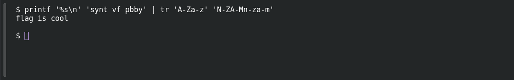

# ROT13

**Platform:** PCGCTF · **Challenge ID:** 34 · **Category:** Cryptography · **Points:** 100

**Status:** Solved in the last PCGCTF snapshot. I reproduced the decode locally for this writeup.

## The challenge

We're handed `synt vf pbby` and the title tells us the method: ROT13.

## Solving it

ROT13 shifts each letter by 13 places. A short way to decode the supplied text is:

```sh
printf '%s\n' 'synt vf pbby' | tr 'A-Za-z' 'N-ZA-Mn-za-m'
```

```text
flag is cool
```

The message contains spaces, which are preserved in the flag.

## Screenshot

Fresh local reproduction using the command described above.



## Flag

```text
pcgCTF{flag is cool}
```

## Takeaway

ROT13 applies the same letter substitution when encoding and decoding.

## Reference

- [Original challenge and attachments](</home/nightingale/CTF/PCGCTF/solved/cryptography/034-rot13/README.md>)
