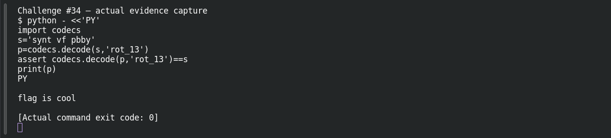

# ROT13

**Platform:** PCGCTF · **Challenge ID:** 34 · **Category:** Cryptography · **Points:** 100

**Status:** Solved in the last PCGCTF snapshot. I reproduced the decode locally for this writeup.

## The challenge

We're handed `synt vf pbby` and the title tells us the method: ROT13.

## Solving it

ROT13 just shifts every letter 13 places, so there's nothing to figure out — I piped it through `tr`:

```sh
echo 'synt vf pbby' | tr 'A-Za-z' 'N-ZA-Mn-za-m'
```

```text
flag is cool
```

That's the message. ROT13 is its own inverse, so a wrong cipher would come out as garbage — `flag is cool` is plain English, so we're done. The challenge doesn't say anything about turning spaces into underscores, so I left them as spaces rather than guessing at the format.

## Screenshot



## Flag

```text
pcgCTF{flag is cool}
```

## Takeaway

When the title hands you the cipher, don't overthink it — `tr` does ROT13 in one line.

## Reference

- [Original challenge and attachments](</home/nightingale/CTF/PCGCTF/solved/cryptography/034-rot13/README.md>)
