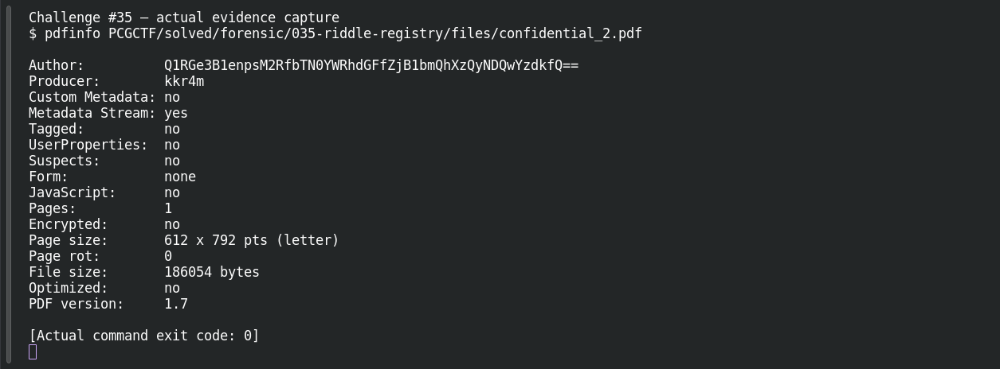
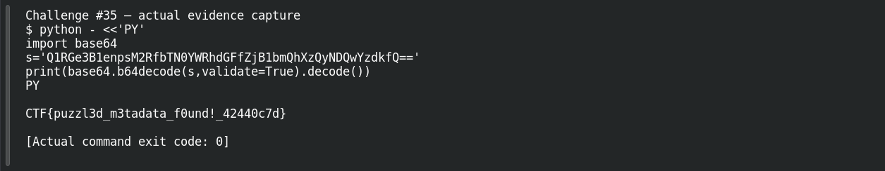

# Riddle Registry

**Platform:** PCGCTF · **Challenge ID:** 35 · **Category:** Forensic · **Points:** 200

**Difficulty:** Not recorded in the available platform metadata.

**Verification status:** Verified — solved in the last PCGCTF snapshot. Local evidence independently reproduced; exact historical platform submission is not newly tested.

## Challenge and objective

Recover the flag hidden in a PDF’s metadata rather than in its visible page content.

Original description: [saved challenge description](</home/nightingale/CTF/PCGCTF/solved/forensic/035-riddle-registry/README.md>). Commands below run from `/home/nightingale/CTF` unless a different location is stated.

## Initial analysis

The description explicitly warns that the visible text is a decoy and names metadata as the relevant layer. PDF metadata can contain document title, author and producer values independent of the rendered page. The Author field is especially conspicuous here because it is a long Base64-looking string instead of a person’s name.

## Step-by-step solution

### 1. Read document information without rendering the decoy

`pdfinfo` reads the PDF information dictionary and basic structure. It does not require interpreting the visible prose as a cipher. The full output was collected during this drafting pass; the decisive excerpt is the Author value.

```sh
pdfinfo PCGCTF/solved/forensic/035-riddle-registry/files/confidential_2.pdf
```

**Recorded output / observation:**

```text
Author: Q1RGe3B1enpsM2RfbTN0YWRhdGFfZjB1bmQhXzQyNDQwYzdkfQ==
Producer: kkr4m
Pages: 1
Encrypted: no
```

The Author string’s alphabet and padding fit Base64. Decoding that field is a direct test of the planted clue.

### 2. Decode the anomalous Author field

Strict Base64 decoding converts the metadata value into bytes and UTF-8 text. No password is necessary: the data was hidden by placement and representation, not encrypted.

```sh
python - <<'PY'
import base64
s='Q1RGe3B1enpsM2RfbTN0YWRhdGFfZjB1bmQhXzQyNDQwYzdkfQ=='
print(base64.b64decode(s,validate=True).decode())
PY
```

**Recorded output / observation:**

```text
CTF{puzzl3d_m3tadata_f0und!_42440c7d}
```

This is the exact recovered source string. The saved challenge description provides no explicit conversion rule for the prefix, so preserve it rather than rewriting it silently.

## Captured screenshots and evidence

Captured on 2026-10-29 from actual terminal sessions or browser views. Captions distinguish new results, preserved records, source images and blockers. No platform acceptance is inferred from these images.

### Challenge #35 — actual evidence capture



Fresh execution of the documented offline step.

Command/action actually executed:

```sh
pdfinfo PCGCTF/solved/forensic/035-riddle-registry/files/confidential_2.pdf
```

[Actual command transcript](../screenshots/capture-work/035-step-1.terminal.log) · [Execution record](../screenshots/capture-work/035-step-1.result.json). Notice the result fields discussed in the corresponding solution step; the transcript retains lines that extend beyond the screenshot viewport.

### Challenge #35 — actual evidence capture



Fresh execution of the documented offline step.

Command/action actually executed:

```sh
python - <<'PY'
import base64
s='Q1RGe3B1enpsM2RfbTN0YWRhdGFfZjB1bmQhXzQyNDQwYzdkfQ=='
print(base64.b64decode(s,validate=True).decode())
PY
```

[Actual command transcript](../screenshots/capture-work/035-step-2.terminal.log) · [Execution record](../screenshots/capture-work/035-step-2.result.json). Notice the result fields discussed in the corresponding solution step; the transcript retains lines that extend beyond the screenshot viewport.

## Flag discovery and verification

Saved result / candidate:

```text
CTF{puzzl3d_m3tadata_f0und!_42440c7d}
```

Local evidence independently reproduced; exact historical platform submission is not newly tested.

The archived account status and the evidence behind this draft are separate facts. No new PCGCTF acceptance is claimed. Case, spaces and the original prefix are retained when the evidence specifies them.

## Remaining review tasks

- The available command results are captured below. Preserve a real acceptance record if a later platform verification is performed.

## What this challenge taught me

Inspect container metadata when the description points away from rendered content. An odd author field can be decisive evidence without requiring a complicated PDF exploit.

## Evidence and attribution

- [Original challenge and attachments](</home/nightingale/CTF/PCGCTF/solved/forensic/035-riddle-registry/README.md>)
- [035-pdfinfo.txt](</home/nightingale/CTF/PCGCTF/final-writeups/evidence-solved/035-pdfinfo.txt>)
