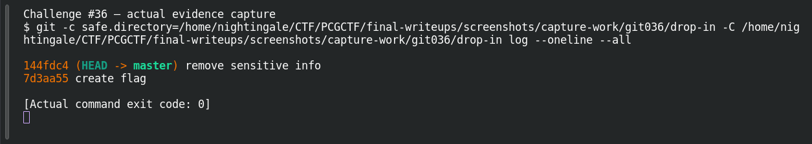
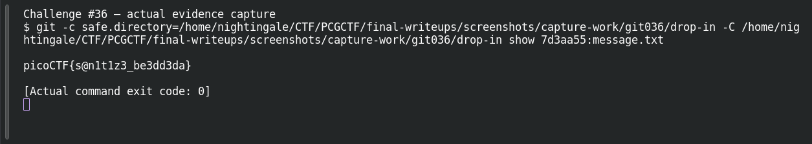

# Commitment Issues

**Platform:** PCGCTF · **Challenge ID:** 36 · **Category:** General Skills · **Points:** 250

**Status:** Solved in the last snapshot; reproduced locally.

## The challenge

The flag was in `message.txt` but a later commit removed it. It's still in the Git history.

## Solving it

Deleting a line in a new commit doesn't erase the old blob. I unzipped the repo and looked at the log across all refs:

```sh
git -C drop-in log --oneline --all
```

```text
144fdc4 remove sensitive info
7d3aa55 create flag
```

The "create flag" commit is the one I want. Instead of checking it out, I just read the old version of the file directly:

```sh
git -C drop-in show 7d3aa55:message.txt
```

```text
picoCTF{s@n1t1z3_be3dd3da}
```

Source prefix is picoCTF; the challenge gives no replacement, so I kept it.

## Screenshots





## Flag

```text
picoCTF{s@n1t1z3_be3dd3da}
```

## Takeaway

Version control keeps what a plain `cat` of the current file misses. `git show commit:path` reads an old blob without touching your working tree. (Worth remembering the flip side too: unreachable objects can eventually get pruned, so history recovery isn't forever.)

## References

- [Original challenge and attachments](</home/nightingale/CTF/PCGCTF/solved/general-skills/036-commitment-issues/README.md>)
