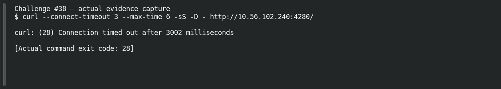

# The Lazy Gatekeeper

**Platform:** PCGCTF · **Challenge ID:** 38 · **Category:** Web Exploitation - DVWA · **Points:** 50

**Difficulty:** Not recorded in the available platform metadata.

**Verification status:** Verified — solved in the last PCGCTF snapshot. Solved in the historical snapshot; official defaults support the approach, but current deployment output and exact historical flag are missing.

## Challenge and objective

Determine which original account the unchanged DVWA gatekeeper trusted.

Original description: [saved challenge description](</home/nightingale/CTF/PCGCTF/solved/web-exploitation-dvwa/038-the-lazy-gatekeeper/README.md>). Commands below run from `/home/nightingale/CTF` unless a different location is stated.

## Initial analysis

The “original keys” language suggests default credentials rather than an injection attack. The legitimate DVWA project documents a default web username of admin and password of password. That is relevant background, but the saved material does not contain the original login response or exact submitted flag, so the account hypothesis must stay distinct from a reproduced solve.

## Step-by-step solution

### 1. Check the original target and defaults

This private-address target is the one named by the challenge. The official project’s defaults provide a reasoned initial account to test; they do not authorize broad scanning or imply that this particular deployment is currently reachable.

```sh
Open http://10.56.102.240:4280/ in the authorized lab, and compare the login screen with the official DVWA README.
```

**Recorded output / observation:**

```text
Official DVWA default username: admin
Official DVWA default password: password
[CURRENT TARGET RESPONSE NOT CAPTURED]
```

The expected account answer is likely admin, but the original accepted flag string is missing. A browser response from this deployment is the needed check.

### 2. Capture the intended account confirmation

A single evidence-backed default-login check is appropriate to this clue. The page may use an anti-CSRF token, so a browser form submission is clearer than guessing a raw POST body. This action is a precise reproduction plan, not a newly successful login.

```sh
Use the default training credentials once on the challenge login form; record the resulting authenticated user label and any challenge-specific text.
```

**Recorded output / observation:**

```text
[SCREENSHOT / RESPONSE NEEDED: actual login result and displayed account identity]
```

If the account is confirmed, record exactly whether the challenge asks for the username alone or reveals a separate flag. Do not infer a successful response from the generic defaults.

## Captured screenshots and evidence

Captured on 2026-10-29 from actual terminal sessions or browser views. Captions distinguish new results, preserved records, source images and blockers. No platform acceptance is inferred from these images.

### Challenge #38 — actual evidence capture



Actual bounded connection attempt to the original private lab. The actual connection failed; the screenshot does not show a working exploit or a recovered flag.

Command/action actually executed:

```sh
curl --connect-timeout 3 --max-time 6 -sS -D - http://10.56.102.240:4280/
```

[Actual command transcript](../screenshots/capture-work/038-target.terminal.log) · [Execution record](../screenshots/capture-work/038-target.result.json). Notice the result fields discussed in the corresponding solution step; the transcript retains lines that extend beyond the screenshot viewport.

**Blocked evidence:** bounded requests could not reach the challenge service. The failure was captured; an authenticated page, exploit result and any flag remain unverified.

## Flag discovery and verification

**Exact recovered flag not available.** The solved snapshot establishes a historical solve, but it does not retain the submitted string. No flag has been invented for this draft.

Solved in the historical snapshot; official defaults support the approach, but current deployment output and exact historical flag are missing.

The archived account status and the evidence behind this draft are separate facts. No new PCGCTF acceptance is claimed. Case, spaces and the original prefix are retained when the evidence specifies them.

Primary reference: [DVWA official README — Default Credentials](https://github.com/digininja/DVWA/blob/master/README.md#default-credentials).

## Remaining review tasks

- Access the named private lab host from the authorized network and capture the actual login result.
- Recover or verify the exact accepted flag text; the snapshot alone does not preserve it.

## What this challenge taught me

Default credentials are an exposure when left unchanged, but a known default is not the same as a confirmed deployment-specific login. Preserve that distinction when reconstructing an old solve.

## Evidence and attribution

- [Original challenge and attachments](</home/nightingale/CTF/PCGCTF/solved/web-exploitation-dvwa/038-the-lazy-gatekeeper/README.md>)
