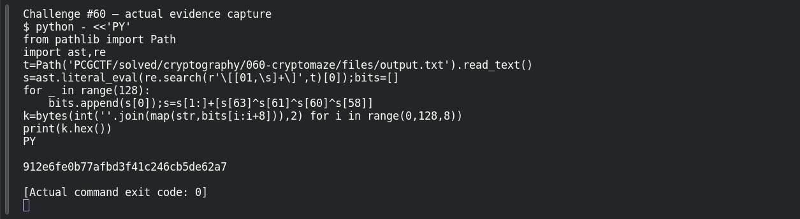
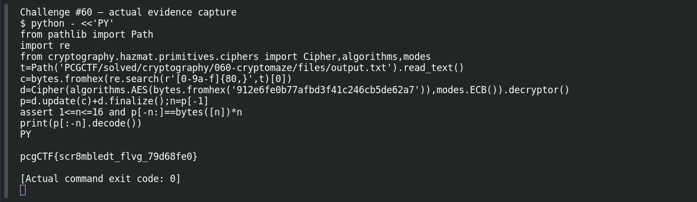

# CryptoMaze

**Platform:** PCGCTF · **Challenge ID:** 60 · **Category:** Cryptography · **Points:** 250

**Status:** Solved in the last snapshot; key and decrypt reproduced locally.

## The challenge

Reproduce the given LFSR's output, turn the first 128 bits into an AES-128 key, and decrypt the ciphertext.

## Solving it

The supplied state and tap positions pin down the LFSR completely — the only things left to decide are the output bit, shift direction and how bits pack into bytes. The convention that gives a clean result: output `state[0]`, shift left, feed back the XOR of the taps, and pack MSB-first. That builds the key:

```sh
python3 -c "
s=[...]  # supplied 64-bit state
bits=[]
for _ in range(128):
    bits.append(s[0]); s=s[1:]+[s[63]^s[61]^s[60]^s[58]]
k=bytes(int(''.join(map(str,bits[i:i+8])),2) for i in range(0,128,8))
print(k.hex())"
```

```text
912e6fe0b77afbd3f41c246cb5de62a7
```

The ciphertext is three AES blocks with no IV, so ECB is the mode that gives coherent plaintext. I decrypted and checked every PKCS#7 padding byte before stripping — not just the last one:

```sh
python3 -c "
from cryptography.hazmat.primitives.ciphers import Cipher,algorithms,modes
d=Cipher(algorithms.AES(bytes.fromhex('912e6fe0b77afbd3f41c246cb5de62a7')),modes.ECB()).decryptor()
p=d.update(ct)+d.finalize(); n=p[-1]
assert p[-n:]==bytes([n])*n
print(p[:-n].decode())"
```

```text
pcgCTF{scr8mbledt_flvg_79d68fe0}
```

## Screenshots





## Flag

```text
pcgCTF{scr8mbledt_flvg_79d68fe0}
```

## Takeaway

A strong block cipher can't save you if the key comes entirely from public, deterministic inputs. Write the generator conventions down explicitly, and validate the decrypted bytes instead of trusting a plausible-looking prefix.

## References

- [Original challenge and attachments](</home/nightingale/CTF/PCGCTF/solved/cryptography/060-cryptomaze/README.md>)
- [Earlier solution / teammate provenance](</home/nightingale/CTF/06_lfsr_aes_writeup.md>)
