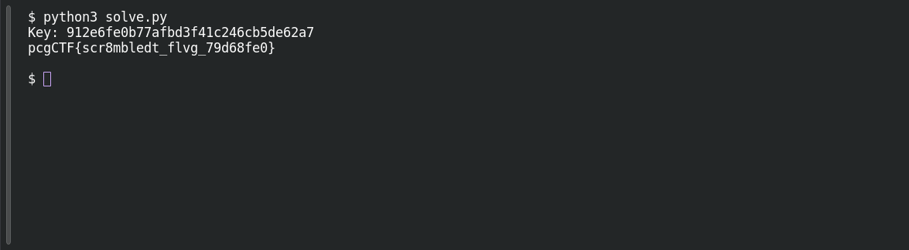

# CryptoMaze

**Platform:** PCGCTF · **Challenge ID:** 60 · **Category:** Cryptography · **Points:** 250

**Status:** Solved in the last snapshot; key and decrypt reproduced locally.

## The challenge

Reproduce the given LFSR's output, turn the first 128 bits into an AES-128 key, and decrypt the ciphertext.

## Solving it

The supplied state and tap positions pin down the LFSR completely — the only things left to decide are the output bit, shift direction and how bits pack into bytes. The convention that gives a clean result: output `state[0]`, shift left, feed back the XOR of the taps, and pack MSB-first. The script below generates the key and decrypts the ciphertext:

Save the following as `solve.py` beside the input file, then run `python3 solve.py`. [Download the script](../scripts/060-solve.py).

```python
from pathlib import Path
import ast
import re
from cryptography.hazmat.primitives.ciphers import Cipher, algorithms, modes

text = Path("output.txt").read_text()
state = ast.literal_eval(re.search(r"\[[01,\s]+\]", text)[0])
bits = []
for _ in range(128):
    bits.append(state[0])
    feedback = state[63] ^ state[61] ^ state[60] ^ state[58]
    state = state[1:] + [feedback]

key = bytes(int("".join(map(str, bits[i:i + 8])), 2)
            for i in range(0, 128, 8))
print("Key:", key.hex())
ciphertext = bytes.fromhex(re.search(r"[0-9a-f]{80,}", text)[0])
decryptor = Cipher(algorithms.AES(key), modes.ECB()).decryptor()
plaintext = decryptor.update(ciphertext) + decryptor.finalize()
padding = plaintext[-1]
assert 1 <= padding <= 16
assert plaintext[-padding:] == bytes([padding]) * padding
print(plaintext[:-padding].decode())
```

```text
Key: 912e6fe0b77afbd3f41c246cb5de62a7
pcgCTF{scr8mbledt_flvg_79d68fe0}
```

The saved solution uses AES-ECB. The script checks all PKCS#7 padding bytes before removing them. An absent IV alone would not identify the cipher mode.

## Screenshots

Fresh local reproduction using the command described above.



## Flag

```text
pcgCTF{scr8mbledt_flvg_79d68fe0}
```

## Takeaway

A strong block cipher can't save you if the key comes entirely from public, deterministic inputs. Write the generator conventions down explicitly, and validate the decrypted bytes instead of trusting a plausible-looking prefix.

## References

- [Original challenge and attachments](</home/nightingale/CTF/PCGCTF/solved/cryptography/060-cryptomaze/README.md>)
- [Earlier solution / teammate provenance](</home/nightingale/CTF/06_lfsr_aes_writeup.md>)
