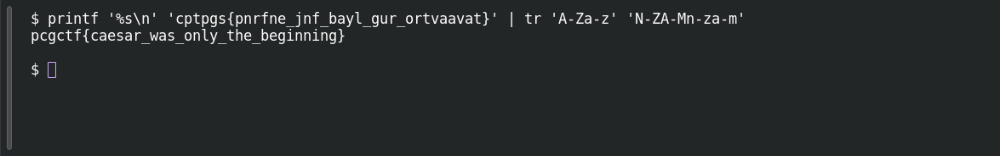

# Caesar's Last Stand

**Platform:** PCGCTF · **Challenge ID:** 63 · **Category:** Cryptography · **Points:** 100

**Status:** Solved in the last snapshot; decode reproduced locally.

## The challenge

Decode `cptpgs{pnrfne_jnf_bayl_gur_ortvaavat}`. The title and the Roman-general theme point at a Caesar cipher.

## Solving it

The braces and underscores survive untouched, so it's a letter substitution. The fragment `gur` maps to `the` under ROT13. One `tr` confirms it:

```sh
echo 'cptpgs{pnrfne_jnf_bayl_gur_ortvaavat}' | tr 'A-Za-z' 'N-ZA-Mn-za-m'
```

```text
pcgctf{caesar_was_only_the_beginning}
```

Every word reads cleanly under the same rotation. The raw output is lowercase `pcgctf`; the challenge displays the wrapper as `pcgCTF`.

## Screenshot

Fresh local reproduction using the command described above.



## Flag

```text
pcgCTF{caesar_was_only_the_beginning}
```

## Takeaway

A known flag shape is a good crib, but a full readable sentence is what actually confirms you picked the right rotation.

## References

- [Original challenge and attachments](</home/nightingale/CTF/PCGCTF/solved/cryptography/063-caesar-s-last-stand/README.md>)
