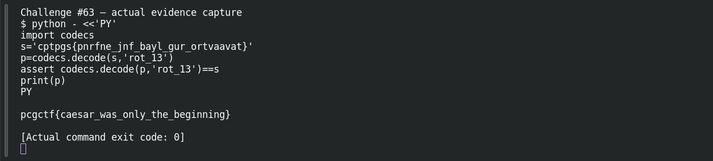

# Caesar's Last Stand

**Platform:** PCGCTF · **Challenge ID:** 63 · **Category:** Cryptography · **Points:** 100

**Difficulty:** Not recorded in the available platform metadata.

**Verification status:** Verified — solved in the last PCGCTF snapshot. Local evidence independently reproduced; exact historical platform submission is not newly tested.

## Challenge and objective

Decode the Roman-cipher clue in `cptpgs{pnrfne_jnf_bayl_gur_ortvaavat}`.

Original description: [saved challenge description](</home/nightingale/CTF/PCGCTF/solved/cryptography/063-caesar-s-last-stand/README.md>). Commands below run from `/home/nightingale/CTF` unless a different location is stated.

## Initial analysis

The flag-shaped braces and underscores survive the transformation, suggesting a substitution of letters rather than encryption of arbitrary bytes. The title and Roman general hint point to a Caesar cipher. ROT13 is a particularly quick candidate because familiar fragments such as `gur` often map to `the` under that rotation.

## Step-by-step solution

### 1. Test the reversible ROT13 candidate

The codec transforms only alphabetic characters. The reverse check ensures no braces, underscores or letters were lost during transcription.

```sh
python - <<'PY'
import codecs
s='cptpgs{pnrfne_jnf_bayl_gur_ortvaavat}'
p=codecs.decode(s,'rot_13')
assert codecs.decode(p,'rot_13')==s
print(p)
PY
```

**Recorded output / observation:**

```text
pcgctf{caesar_was_only_the_beginning}
```

Every word becomes readable in one consistent rotation. The raw decoded prefix is lowercase `pcgctf`; the saved challenge’s displayed wrapper uses `pcgCTF`, so the draft distinguishes raw plaintext from its platform-format candidate.

## Captured screenshots and evidence

Captured on 2026-10-29 from actual terminal sessions or browser views. Captions distinguish new results, preserved records, source images and blockers. No platform acceptance is inferred from these images.

### Challenge #63 — actual evidence capture



Fresh execution of the documented offline step.

Command/action actually executed:

```sh
python - <<'PY'
import codecs
s='cptpgs{pnrfne_jnf_bayl_gur_ortvaavat}'
p=codecs.decode(s,'rot_13')
assert codecs.decode(p,'rot_13')==s
print(p)
PY
```

[Actual command transcript](../screenshots/capture-work/063-step-1.terminal.log) · [Execution record](../screenshots/capture-work/063-step-1.result.json). Notice the result fields discussed in the corresponding solution step; the transcript retains lines that extend beyond the screenshot viewport.

## Flag discovery and verification

Saved result / candidate:

```text
pcgCTF{caesar_was_only_the_beginning}
```

Local evidence independently reproduced; exact historical platform submission is not newly tested.

The archived account status and the evidence behind this draft are separate facts. No new PCGCTF acceptance is claimed. Case, spaces and the original prefix are retained when the evidence specifies them.

Raw decoded text is `pcgctf{caesar_was_only_the_beginning}`. The uppercase `CTF` in the candidate follows the displayed requirement, not a newly observed acceptance response.

## Remaining review tasks

- The available command results are captured below. Preserve a real acceptance record if a later platform verification is performed.

## What this challenge taught me

A known flag structure is a useful crib, but the full sentence and the inverse transformation provide stronger confirmation than a prefix alone.

## Evidence and attribution

- [Original challenge and attachments](</home/nightingale/CTF/PCGCTF/solved/cryptography/063-caesar-s-last-stand/README.md>)
