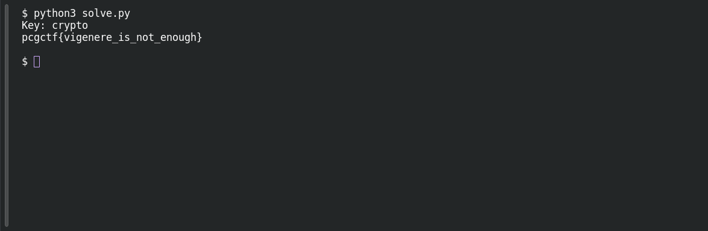

# Broken Vigenere

**Platform:** PCGCTF · **Challenge ID:** 64 · **Category:** Cryptography · **Points:** 100

**Status:** Solved in the last snapshot; decode reproduced locally.

## The challenge

Recover the repeating key and decrypt a Vigenère flag. The ciphertext starts `rtermt{...}`.

## Solving it

We know the plaintext starts `pcgctf`. In Vigenère, ciphertext letter minus plaintext letter (mod 26) gives the key shift at that position, so the first six letters hand us the key:

Save this as `solve.py` and run `python3 solve.py`. [Download the script](../scripts/064-solve.py).

```python
ciphertext = "rtermt{xzetgstv_gh_gcv_vldnuj}"
known_prefix = "pcgctf"
key = "".join(chr((ord(c) - ord(p)) % 26 + ord("a"))
              for c, p in zip(ciphertext, known_prefix))
print("Key:", key)

message = []
position = 0
for letter in ciphertext:
    if "a" <= letter <= "z":
        shift = ord(key[position % len(key)]) - ord("a")
        message.append(chr((ord(letter) - ord("a") - shift) % 26 + ord("a")))
        position += 1
    else:
        message.append(letter)
print("".join(message))
```

```text
Key: crypto
pcgctf{vigenere_is_not_enough}
```

The script recovers the key `crypto` and the complete flag. Punctuation does not advance the key index. The decoded prefix is lowercase `pcgctf`.

## Screenshots

Fresh local reproduction using the command described above.



## Flag

```text
pcgctf{vigenere_is_not_enough}
```

## Takeaway

A repeating key leaks straight through a known plaintext prefix. Keep the key index aligned across punctuation.

## References

- [Original challenge and attachments](</home/nightingale/CTF/PCGCTF/solved/cryptography/064-broken-vigenere/README.md>)
- [Earlier solution / teammate provenance](</home/nightingale/CTF/repeating_key_cipher_writeup.md>)
