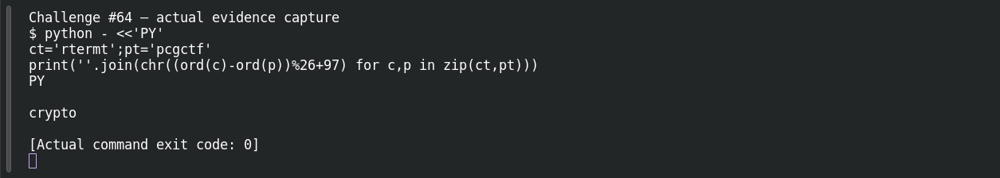
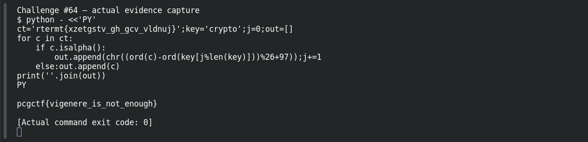

# Broken Vigenere

**Platform:** PCGCTF · **Challenge ID:** 64 · **Category:** Cryptography · **Points:** 100

**Difficulty:** Not recorded in the available platform metadata.

**Verification status:** Verified — solved in the last PCGCTF snapshot. Local evidence independently reproduced; exact historical platform submission is not newly tested.

## Challenge and objective

Recover the repeating key and decrypt the flag-shaped Vigenère ciphertext.

Original description: [saved challenge description](</home/nightingale/CTF/PCGCTF/solved/cryptography/064-broken-vigenere/README.md>). Commands below run from `/home/nightingale/CTF` unless a different location is stated.

## Initial analysis

The known prefix `pcgctf` provides six plaintext letters aligned with ciphertext `rtermt`. In Vigenère, subtracting a known plaintext letter from its ciphertext letter modulo 26 reveals the key shift at that position. Those six shifts spell `crypto`, a compact candidate key that can be tested over the whole message.

## Step-by-step solution

### 1. Recover the key from the known prefix

`zip` pairs the aligned letters. Subtraction modulo 26 turns each pair into a shift, and adding 97 converts shift zero to `a`. This yields a candidate repeating key, not a proof of arbitrary key length.

```sh
python - <<'PY'
ct='rtermt';pt='pcgctf'
print(''.join(chr((ord(c)-ord(p))%26+97) for c,p in zip(ct,pt)))
PY
```

**Recorded output / observation:**

```text
crypto
```

A meaningful six-letter key fits all six known positions; test it on the remaining ciphertext rather than assuming the inference is complete.

### 2. Decrypt while preserving nonletters

The key index advances only when an alphabetic character is decrypted. Braces and underscores remain in place and do not consume a key character. Advancing the index through punctuation would misalign the later words.

```sh
python - <<'PY'
ct='rtermt{xzetgstv_gh_gcv_vldnuj}';key='crypto';j=0;out=[]
for c in ct:
    if c.isalpha():
        out.append(chr((ord(c)-ord(key[j%len(key)]))%26+97));j+=1
    else:out.append(c)
print(''.join(out))
PY
```

**Recorded output / observation:**

```text
pcgctf{vigenere_is_not_enough}
```

The entire flag becomes readable under the same repeated key. The original challenge explicitly uses lowercase `pcgctf`, so retain it.

## Captured screenshots and evidence

Captured on 2026-10-29 from actual terminal sessions or browser views. Captions distinguish new results, preserved records, source images and blockers. No platform acceptance is inferred from these images.

### Challenge #64 — actual evidence capture



Fresh execution of the documented offline step.

Command/action actually executed:

```sh
python - <<'PY'
ct='rtermt';pt='pcgctf'
print(''.join(chr((ord(c)-ord(p))%26+97) for c,p in zip(ct,pt)))
PY
```

[Actual command transcript](../screenshots/capture-work/064-step-1.terminal.log) · [Execution record](../screenshots/capture-work/064-step-1.result.json). Notice the result fields discussed in the corresponding solution step; the transcript retains lines that extend beyond the screenshot viewport.

### Challenge #64 — actual evidence capture



Fresh execution of the documented offline step.

Command/action actually executed:

```sh
python - <<'PY'
ct='rtermt{xzetgstv_gh_gcv_vldnuj}';key='crypto';j=0;out=[]
for c in ct:
    if c.isalpha():
        out.append(chr((ord(c)-ord(key[j%len(key)]))%26+97));j+=1
    else:out.append(c)
print(''.join(out))
PY
```

[Actual command transcript](../screenshots/capture-work/064-step-2.terminal.log) · [Execution record](../screenshots/capture-work/064-step-2.result.json). Notice the result fields discussed in the corresponding solution step; the transcript retains lines that extend beyond the screenshot viewport.

## Flag discovery and verification

Saved result / candidate:

```text
pcgctf{vigenere_is_not_enough}
```

Local evidence independently reproduced; exact historical platform submission is not newly tested.

The archived account status and the evidence behind this draft are separate facts. No new PCGCTF acceptance is claimed. Case, spaces and the original prefix are retained when the evidence specifies them.

## Remaining review tasks

- The available command results are captured below. Preserve a real acceptance record if a later platform verification is performed.

## What this challenge taught me

A repeated key can leak through a known plaintext prefix. The important implementation detail is how punctuation affects key alignment.

## Evidence and attribution

- [Original challenge and attachments](</home/nightingale/CTF/PCGCTF/solved/cryptography/064-broken-vigenere/README.md>)
- [Earlier solution / teammate provenance](</home/nightingale/CTF/repeating_key_cipher_writeup.md>)
- [crypto-reproduction.json](</home/nightingale/CTF/PCGCTF/final-writeups/evidence-solved/crypto-reproduction.json>)
