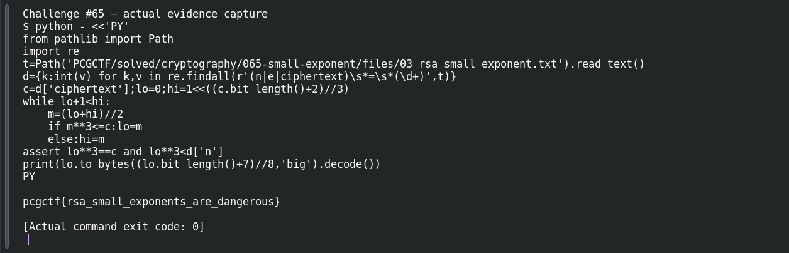

# Small Exponent

**Platform:** PCGCTF · **Challenge ID:** 65 · **Category:** Cryptography · **Points:** 150 · **Difficulty:** Medium

**Status:** Solved in the last snapshot; attack reproduced locally.

## The challenge

RSA with public exponent `e = 3`, and a short unpadded message. The classic setup.

## Solving it

RSA is `c = m^3 mod n`. If the message is short enough that `m^3 < n`, the modulus never actually reduces anything — so the ciphertext is just a plain perfect cube and you recover `m` by taking the integer cube root. No factoring needed. I used integer binary search for the cube root (floats lose precision at this size) and checked the cube is exact:

```sh
python3 -c "
c=CIPHERTEXT
lo,hi=0,1<<((c.bit_length()+2)//3)
while lo+1<hi:
    m=(lo+hi)//2
    lo,hi=(m,hi) if m**3<=c else (lo,m)
assert lo**3==c
print(lo.to_bytes((lo.bit_length()+7)//8,'big').decode())"
```

```text
pcgctf{rsa_small_exponents_are_dangerous}
```

The exact-root check plus readable plaintext confirm it — no private key involved.

## Screenshot



## Flag

```text
pcgctf{rsa_small_exponents_are_dangerous}
```

## Takeaway

The bug isn't "e=3" by itself — it's unpadded low-exponent RSA with a small enough message. Test the exact precondition (`m^3 == c`) rather than treating any near-root as the answer.

## References

- [Original challenge and attachments](</home/nightingale/CTF/PCGCTF/solved/cryptography/065-small-exponent/README.md>)
- [Earlier solution / teammate provenance](</home/nightingale/CTF/03_rsa_small_exponent_writeup.md>)
