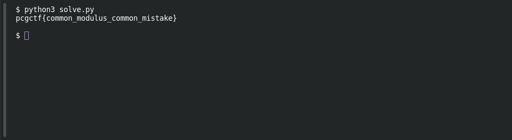

# Common Modulus

**Platform:** PCGCTF · **Challenge ID:** 66 · **Category:** Cryptography · **Points:** 250 · **Difficulty:** Medium

**Status:** Solved in the last snapshot; attack reproduced locally.

## The challenge

The same message is encrypted under one modulus `n` with two coprime exponents (`e1=3`, `e2=5`). Recover it.

## Solving it

Shared modulus, coprime exponents → common-modulus attack. Bézout gives `2·3 − 1·5 = 1`, so `c1² · c2⁻¹ mod n` cancels the exponents and leaves the message. No private exponent required. I verified by re-encrypting the result under both public keys:

Save the following as `solve.py` beside the input file, then run `python3 solve.py`. [Download the script](../scripts/066-solve.py).

```python
from pathlib import Path
import re

text = Path("04_rsa_common_modulus.txt").read_text()
values = {name: int(value) for name, value in
          re.findall(r"(n|e1|e2|c1|c2)\s*=\s*(\d+)", text)}
n, c1, c2 = values["n"], values["c1"], values["c2"]
assert 2 * values["e1"] - values["e2"] == 1
message = pow(c1, 2, n) * pow(c2, -1, n) % n
assert pow(message, values["e1"], n) == c1
assert pow(message, values["e2"], n) == c2
print(message.to_bytes((message.bit_length() + 7) // 8, "big").decode())
```

```text
pcgctf{common_modulus_common_mistake}
```

The recovered message reproduces both ciphertexts, so the algebra is right.

## Screenshot

Fresh local reproduction using the command described above.



## Flag

```text
pcgctf{common_modulus_common_mistake}
```

## Takeaway

Reusing one modulus across different exponents turns two separate encryptions into one solvable equation. Re-encrypting the result is much stronger proof than just spotting a flag prefix.

## References

- [Original challenge and attachments](</home/nightingale/CTF/PCGCTF/solved/cryptography/066-common-modulus/README.md>)
- [Earlier solution / teammate provenance](</home/nightingale/CTF/04_rsa_common_modulus_writeup.md>)
