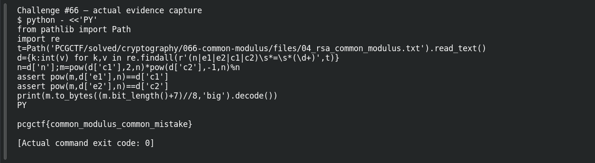

# Common Modulus

**Platform:** PCGCTF · **Challenge ID:** 66 · **Category:** Cryptography · **Points:** 250 · **Difficulty:** Medium

**Status:** Solved in the last snapshot; attack reproduced locally.

## The challenge

The same message is encrypted under one modulus `n` with two coprime exponents (`e1=3`, `e2=5`). Recover it.

## Solving it

Shared modulus, coprime exponents → common-modulus attack. Bézout gives `2·3 − 1·5 = 1`, so `c1² · c2⁻¹ mod n` cancels the exponents and leaves the message. No private exponent required. I verified by re-encrypting the result under both public keys:

```sh
python3 -c "
m = pow(c1,2,n) * pow(c2,-1,n) % n
assert pow(m,3,n)==c1 and pow(m,5,n)==c2
print(m.to_bytes((m.bit_length()+7)//8,'big').decode())"
```

```text
pcgctf{common_modulus_common_mistake}
```

The recovered message reproduces both ciphertexts, so the algebra is right.

## Screenshot



## Flag

```text
pcgctf{common_modulus_common_mistake}
```

## Takeaway

Reusing one modulus across different exponents turns two separate encryptions into one solvable equation. Re-encrypting the result is much stronger proof than just spotting a flag prefix.

## References

- [Original challenge and attachments](</home/nightingale/CTF/PCGCTF/solved/cryptography/066-common-modulus/README.md>)
- [Earlier solution / teammate provenance](</home/nightingale/CTF/04_rsa_common_modulus_writeup.md>)
