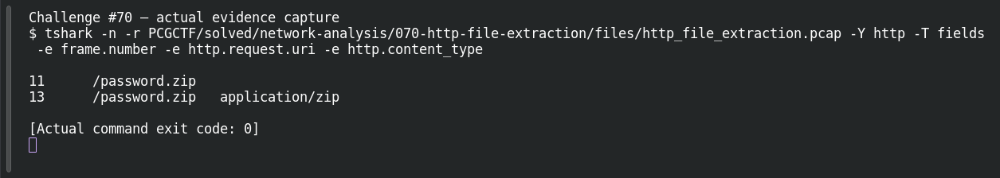
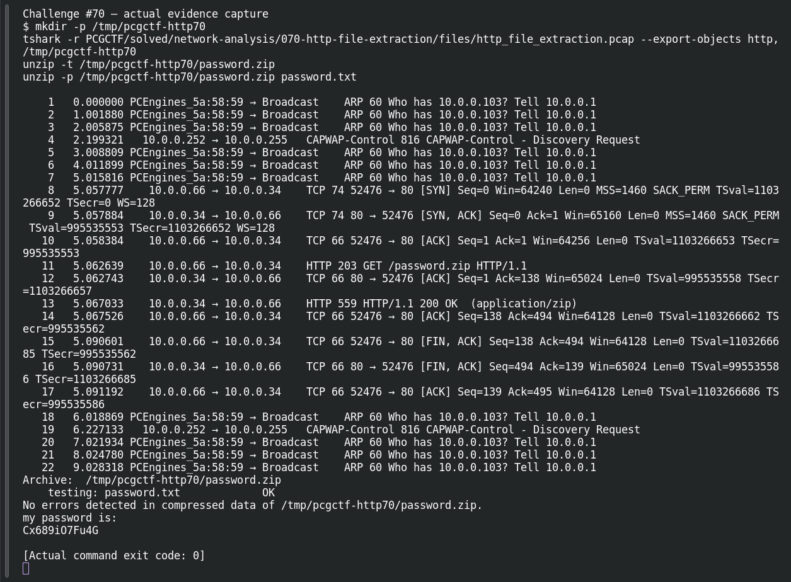

# HTTP File Extraction

**Platform:** PCGCTF · **Challenge ID:** 70 · **Category:** Network Analysis · **Points:** 150

**Status:** Solved in the last snapshot; reproduced locally. (This capture is byte-identical to Hidden Download #62 — same file, reused extraction.)

## The challenge

A ZIP was downloaded over HTTP in a packet capture. Pull it out and read the password in its text file.

## Solving it

Since the capture holds the full HTTP transaction, I can rebuild the file from the response bytes without touching the real host. First, find the download:

```sh
tshark -nr http_file_extraction.pcap -Y http -T fields -e frame.number -e http.request.uri -e http.content_type
```

```text
11  GET /password.zip
13  application/zip
```

Then export the HTTP objects, check the archive, and print the member:

```sh
tshark -r http_file_extraction.pcap --export-objects http,/tmp/out
unzip -p /tmp/out/password.zip password.txt
```

```text
my password is:
Cx689iO7Fu4G
```

That text file's contents are the answer — not the ZIP or any HTTP auth password. Case and digits matter.

## Screenshots





## Flag

```text
pcgCTF{Cx689iO7Fu4G}
```

## Takeaway

Reassemble the actual object instead of grepping raw packet bytes, and keep the secret inside the file distinct from transport metadata around it.

## References

- [Original challenge and attachments](</home/nightingale/CTF/PCGCTF/solved/network-analysis/070-http-file-extraction/README.md>)
- [Extracted archive](</home/nightingale/CTF/PCGCTF/analysis-network-analysis/hidden-download-objects/password.zip>)
