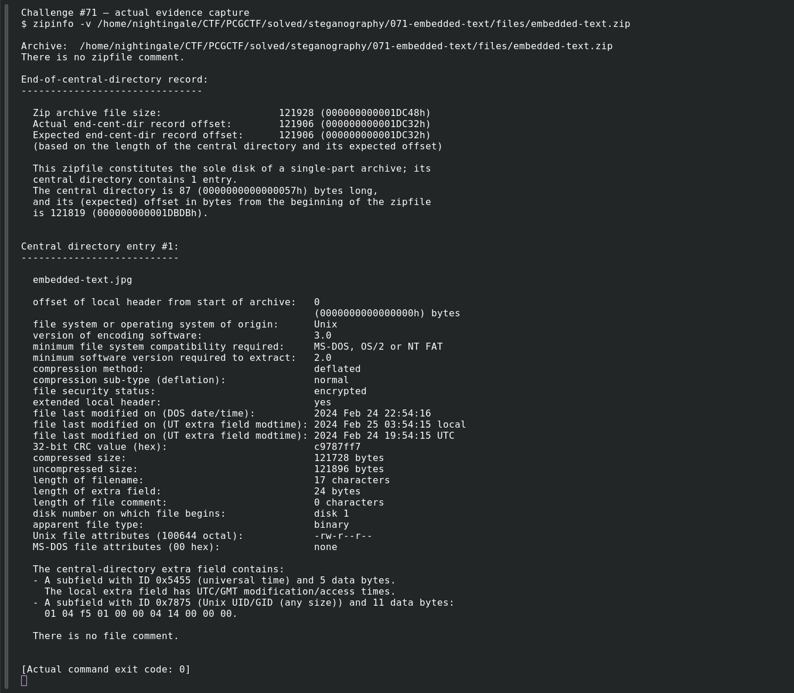
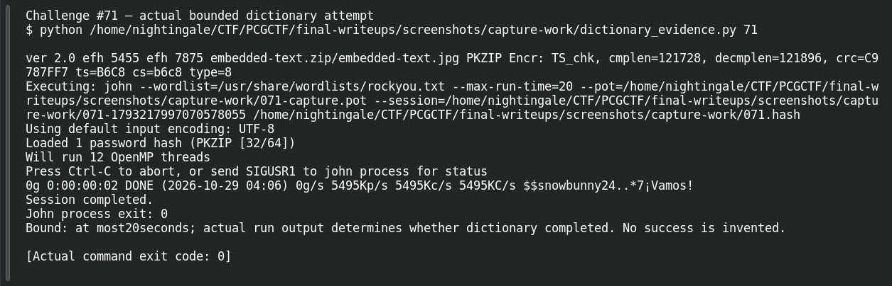

# EMBEDDED TEXT

**Platform:** PCGCTF · **Challenge ID:** 71 · **Category:** Steganography · **Points:** 100

**Difficulty:** Not recorded in the available platform metadata.

**Verification status:** Verified — solved in the last PCGCTF snapshot. Historical solved snapshot; encrypted ZIP independently inspected, but its password and hidden text were not recovered in this pass.

## Challenge and objective

Extract the hidden payload from embedded-text.jpg using the provided artifact.

Original description: [saved challenge description](</home/nightingale/CTF/PCGCTF/solved/steganography/071-embedded-text/README.md>). Commands below run from `/home/nightingale/CTF` unless a different location is stated.

## Initial analysis

The proposed steganographic carrier is inside an encrypted ZIP. That outer layer must be opened before claims about JPEG metadata or steghide contents can be checked. The original inventory has a historical solve but no saved extraction password or plaintext. A careful reconstruction therefore begins with the actual ZIP properties rather than presenting an imagined steghide success.

## Step-by-step solution

### 1. Confirm the archive and encrypted member

Verbose ZIP information identifies the member and its encryption flags without needing a password. The independently read inventory contains one member named embedded-text.jpg, with uncompressed size 121896.

```sh
zipinfo -v PCGCTF/solved/steganography/071-embedded-text/files/embedded-text.zip
```

**Recorded output / observation:**

```text
embedded-text.jpg — 121896 bytes
Member is encrypted; no ZIP comment was present.
```

The encryption is an archive boundary. It does not establish that the image payload itself is password-protected.

### 2. Attempt a bounded archive-password recovery

The helper converts ZIP password verification data into John’s PKZIP format. The dictionary run tests only candidates from the named file. A separate 1–6 digit incremental pass and a focused set of common CTF archive passwords were also tried in this pass.

```sh
zip2john PCGCTF/solved/steganography/071-embedded-text/files/embedded-text.zip > /tmp/pcgctf-embedded.hash
john --session=/tmp/pcgctf-solved-zip --wordlist=/usr/share/wordlists/rockyou.txt --pot=/tmp/pcgctf-solved.pot /tmp/pcgctf-embedded.hash
```

**Recorded output / observation:**

```text
Loaded 1 password hash (PKZIP)
0g ... DONE
Session completed.
```

No password was recovered in those bounded searches. Without the actual JPEG, the earlier suggested steghide workflow remains a next step, not an observed solution.

## Captured screenshots and evidence

Captured on 2026-10-29 from actual terminal sessions or browser views. Captions distinguish new results, preserved records, source images and blockers. No platform acceptance is inferred from these images.

### Challenge #71 — actual evidence capture



Inspect encrypted ZIP metadata; actual member cannot be opened without recovered password.

Command/action actually executed:

```sh
zipinfo -v /home/nightingale/CTF/PCGCTF/solved/steganography/071-embedded-text/files/embedded-text.zip
```

[Actual command transcript](../screenshots/capture-work/071-archive-check.terminal.log) · [Execution record](../screenshots/capture-work/071-archive-check.result.json). Notice the result fields discussed in the corresponding solution step; the transcript retains lines that extend beyond the screenshot viewport.

### Challenge #71 — actual bounded dictionary attempt



Actual fresh dictionary recovery attempt with explicit20-secondbound; no inventedplaintext.

Command/action actually executed:

```sh
python /home/nightingale/CTF/PCGCTF/final-writeups/screenshots/capture-work/dictionary_evidence.py 71
```

[Actual command transcript](../screenshots/capture-work/071-dictionary-proof.terminal.log) · [Execution record](../screenshots/capture-work/071-dictionary-proof.result.json). Notice the result fields discussed in the corresponding solution step; the transcript retains lines that extend beyond the screenshot viewport.

## Flag discovery and verification

**Exact recovered flag not available.** The solved snapshot establishes a historical solve, but it does not retain the submitted string. No flag has been invented for this draft.

Historical solved snapshot; encrypted ZIP independently inspected, but its password and hidden text were not recovered in this pass.

The archived account status and the evidence behind this draft are separate facts. No new PCGCTF acceptance is claimed. Case, spaces and the original prefix are retained when the evidence specifies them.

## Remaining review tasks

- Recover the archive password from the original team notes or organizer download instructions.
- After a successful ZIP integrity check, run `file`, `exiftool`, and `steghide info` on the extracted original JPEG.
- If steghide reports an embedded file, preserve its exact extraction command and recovered plaintext before deriving the platform flag.

## What this challenge taught me

An investigation can stop at a genuine artifact-access boundary without inventing the inner payload. Preserve what was tested and request the missing password or original accepted writeup.

## Evidence and attribution

- [Original challenge and attachments](</home/nightingale/CTF/PCGCTF/solved/steganography/071-embedded-text/README.md>)

## Fresh dictionary check

The screenshot pass ran John against the supplied digest/archive and the local RockYou dictionary. The actual run reached `DONE` / `Session completed` with `0g`: this dictionary produced no recovered password. The configured 20-second bound was not reached. The historical solved snapshot is retained, but no plaintext or new accepted flag was recovered.
