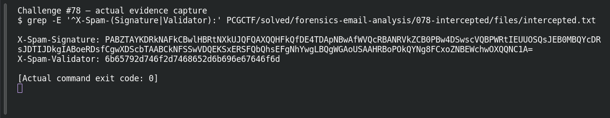
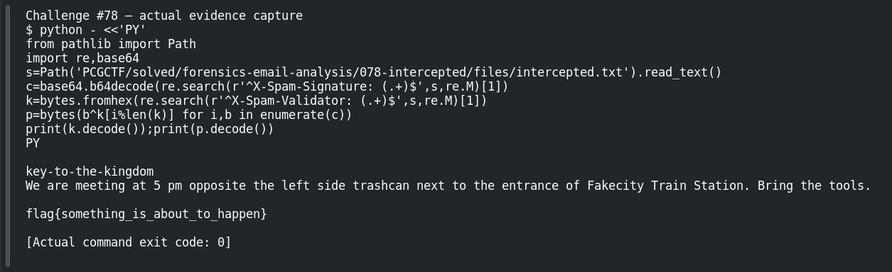

# INTERCEPTED

**Platform:** PCGCTF · **Challenge ID:** 78 · **Category:** Forensics / Email Analysis · **Points:** 150

**Status:** Solved in the last snapshot; reproduced locally.

## The challenge

An intercepted email hides a message in its custom headers. The body is just a meeting pretext.

## Solving it

Most long mail headers are ordinary DKIM/ARC signatures, so the trick is not to treat every random-looking string as ciphertext. The two that stand out are a matching pair — `X-Spam-Signature` (Base64-shaped) and `X-Spam-Validator` (hex):

```sh
grep -E '^X-Spam-(Signature|Validator):' intercepted.txt
```

```text
X-Spam-Signature: PABZTAYKDRkNAFkCBwlHBRtN...
X-Spam-Validator: 6b65792d746f2d7468652d6b696e67646f6d
```

The validator hex decodes to `key-to-the-kingdom` — a key. The signature is Base64 of ciphertext. So it's repeating-key XOR: Base64-decode the signature, use the validator as the key, XOR (which is its own inverse):

```sh
python3 -c "
import base64
c=base64.b64decode(SIGNATURE); k=b'key-to-the-kingdom'
print(bytes(b^k[i%len(k)] for i,b in enumerate(c)).decode())"
```

```text
We are meeting at 5 pm opposite the left side trashcan next to the entrance
of Fakecity Train Station. Bring the tools.
flag{something_is_about_to_happen}
```

A coherent message plus a full flag — the two headers were a key/ciphertext pair.

## Screenshots





## Flag

```text
pcgCTF{something_is_about_to_happen}
```

## Takeaway

Header names can disguise a covert channel as routine spam metadata. Tell an arbitrary signature apart from a linked key/ciphertext pair, and check the whole recovered message, not just the flag line.

## References

- [Original challenge and attachments](</home/nightingale/CTF/PCGCTF/solved/forensics-email-analysis/078-intercepted/README.md>)
- [Decoded message](</home/nightingale/CTF/PCGCTF/final-writeups/evidence-solved/078-decoded.txt>)
