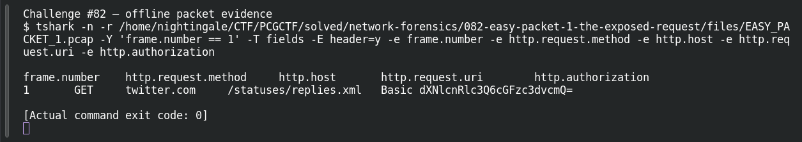

# EASY PACKET 1  The Exposed Request

| Item | Record |
|---|---|
| Platform | PCGCTF |
| Challenge ID | 82 |
| Category | Network Forensics |
| Points | 100 |
| Difficulty | Not separately recorded in the available inventory |
| Verification | Verified — marked solved in the original authenticated PCGCTF snapshot. The offline extraction below was reproduced for this draft; no fresh platform submission was made. |

## Challenge and objective

Recover the username and password exposed by the HTTP Basic Authorization header.

The original description and prerequisite chain are preserved in [the challenge README](../../solved/network-forensics/082-easy-packet-1-the-exposed-request/README.md). The supplied evidence is `EASY_PACKET_1.pcap`; related storyline questions reuse the same capture rather than providing another download.

## Initial analysis

The useful clue is the Authorization header, not the fact that the capture contains only one packet. HTTP Basic represents a username and password as Base64 text. Base64 is reversible encoding, so the entire credential pair is recoverable without guessing a key.

I kept the original capture intact and used offline packet analysis. The file’s SHA-256 is `e4735559a704fcd56ac790602e875a713f94a665af16ecd3ad49ea40ff394faa`. This identifies the exact evidence behind the frame references; no reconstructed program was executed and no request was sent to an address found inside the capture.

## Step-by-step solution

### 1. Inspect the relevant HTTP fields

I started with the request headers. The request is GET /statuses/replies.xml and its Host is twitter.com. The Authorization field contains Basic followed by dXNlcnRlc3Q6cGFzc3dvcmQ=. Separating the scheme from its token gives the exact text to decode.

```sh
tshark -n \
  -r /home/nightingale/CTF/PCGCTF/solved/network-forensics/082-easy-packet-1-the-exposed-request/files/EASY_PACKET_1.pcap \
  -Y 'frame.number == 1' \
  -T fields -E header=y -e frame.number -e http.request.method -e http.host -e http.request.uri -e http.authorization
```

`-n` disables address/name resolution so that recorded numeric addresses stay visible. `-r` reads the existing capture, and `-Y` applies a display filter after decoding. `-T fields` outputs selected fields; each `-e` adds one named column, and `-E header=y` records the column names. `frame.number == 1` is appropriate because the independent capture count is one; it is not being used to prove that count.

**Actual reproduced output** (tab-separated; full lines are preserved in the linked TSV):

```text
frame.number	http.request.method	http.host	http.request.uri	http.authorization
1	GET	twitter.com	/statuses/replies.xml	Basic dXNlcnRlc3Q6cGFzc3dvcmQ=
```

### 2. Interpret the result

Decoding the token produces usertest:password. The colon separates the username from the password inside the HTTP Basic payload. That colon is a protocol delimiter; it does not automatically establish how the CTF grader wants the two values written.

### Decode the Basic credential token

```sh
python - <<'PY'
import base64
token = 'dXNlcnRlc3Q6cGFzc3dvcmQ='
print(base64.b64decode(token, validate=True).decode('ascii'))
PY
```

The string is the token captured after `Basic`, not a guessed password. `validate=True` rejects malformed Base64 instead of silently ignoring invalid characters, and ASCII decoding makes the resulting credential delimiters explicit. Independently reproduced result:

```text
usertest:password
```

The username is `usertest` and the password is `password`. These are challenge-provided demonstration credentials recovered from the supplied capture. The result leads directly to the answer; no login attempt against Twitter or any external service is necessary. The scheme’s representation and TLS requirement are described in [RFC 7617](https://www.rfc-editor.org/rfc/rfc7617.html).

## Captured screenshots and evidence

Captured on 2026-10-29 from actual terminal sessions or browser views. Captions distinguish new results, preserved records, source images and blockers. No platform acceptance is inferred from these images.

### Challenge #82 — offline packet evidence



Fresh execution of the draft’s field-specific TShark command.

Command/action actually executed:

```sh
tshark -n -r /home/nightingale/CTF/PCGCTF/solved/network-forensics/082-easy-packet-1-the-exposed-request/files/EASY_PACKET_1.pcap -Y 'frame.number == 1' -T fields -E header=y -e frame.number -e http.request.method -e http.host -e http.request.uri -e http.authorization
```

[Actual command transcript](../screenshots/capture-work/082-network.terminal.log) · [Execution record](../screenshots/capture-work/082-network.result.json). Notice the result fields discussed in the corresponding solution step; the transcript retains lines that extend beyond the screenshot viewport.

## Flag discovery and verification

**Identified answer:** username `usertest`, password `password`; decoded representation `usertest:password`. The original scoreboard snapshot marks #82 solved, but it does not retain the accepted submission text. The slash form reported accepted for the separate #111 question must not be silently assumed to be #82’s accepted form. Record the original accepted answer from the platform or organizer before calling an exact flag string confirmed.

## Conclusion and lesson

Treat an encoded secret as exposed when the transport is readable. Capture both the raw header and the decoded value, and keep the packet representation separate from CTF answer formatting. The remaining task is to document the accepted submission wording; the technical finding itself is already reproduced.

## Reproduction evidence and references

- [Original challenge description](../../solved/network-forensics/082-easy-packet-1-the-exposed-request/README.md)
- [Actual TShark field output](../evidence/network/082-fields.tsv)
- [Commands, hashes and reproduction results](../evidence/network/reproduction.json)
- [TShark version](../evidence/network/tshark-version.txt)
- [TShark official manual](https://www.wireshark.org/docs/man-pages/tshark.html)
