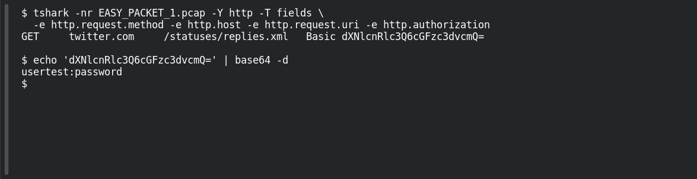

# EASY PACKET 1 — The Exposed Request

**Platform:** PCGCTF · **Challenge ID:** 82 · **Category:** Network Forensics · **Points:** 100

**Status:** Solved in the authenticated snapshot; reproduced from the capture.

**Evidence:** Packet 1 · TCP stream 0 · [EASY_PACKET_1.pcap](../../solved/network-forensics/082-easy-packet-1-the-exposed-request/files/EASY_PACKET_1.pcap).

## The challenge

Recover the username and password leaked by an HTTP Basic Authorization header. The evidence is `EASY_PACKET_1.pcap`, the shared capture for this series.

## Solving it

I pulled the request line and auth header out of the single packet:

```sh
tshark -nr EASY_PACKET_1.pcap -Y http -T fields \
  -e http.request.method -e http.host -e http.request.uri -e http.authorization
```

```text
GET	twitter.com	/statuses/replies.xml	Basic dXNlcnRlc3Q6cGFzc3dvcmQ=
```

HTTP Basic is just Base64 of `username:password`, so the credential is fully recoverable — decode the token after `Basic`:

```sh
echo 'dXNlcnRlc3Q6cGFzc3dvcmQ=' | base64 -d
```

```text
usertest:password
```

So the username is `usertest` and the password is `password`. (No need to log in anywhere — the capture already has it.)

## Screenshot

Fresh local reproduction using the commands described above.



## Flag

```text
pcgCTF{usertest:password}
```

The colon is the Basic-auth delimiter; if the grader wanted the two values written differently, that'd be the only thing to adjust.

## Takeaway

HTTP Basic over plain HTTP hands credentials to anyone with the capture — it's encoding, not encryption. ([RFC 7617](https://www.rfc-editor.org/rfc/rfc7617.html).)

## Reference

- [Original challenge description](../../solved/network-forensics/082-easy-packet-1-the-exposed-request/README.md)
