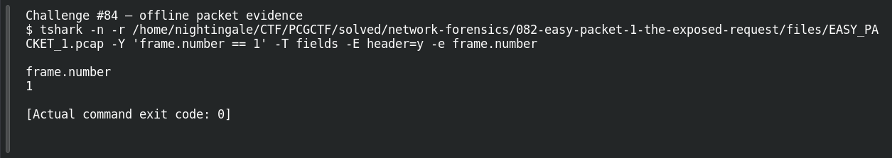

# EASY PACKET 1 #02 — One Packet Wonder

**Platform:** PCGCTF · **Challenge ID:** 84 · **Category:** Network Forensics · **Points:** 100

**Status:** Solved in the authenticated snapshot; field re-pulled from the capture for this writeup.

## The challenge

Count the packets in the capture. The evidence is `EASY_PACKET_1.pcap`, the shared capture for this whole series.

## Solving it

I just counted the frames:
```sh
tshark -nr EASY_PACKET_1.pcap | wc -l
```

```text
1
```

There's exactly one packet — which is also why every other question in this series reads from frame 1.

## Screenshot



## Flag

```text
pcgCTF{1}
```

## Reference

- [Original challenge description](../../solved/network-forensics/084-easy-packet-1-02-one-packet-wonder/README.md)
