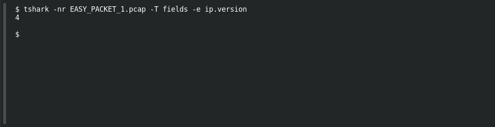

# EASY PACKET 1 #06 — Version Four

**Platform:** PCGCTF · **Challenge ID:** 88 · **Category:** Network Forensics · **Points:** 100

**Status:** Solved in the authenticated snapshot; field re-pulled from the capture for this writeup.

**Evidence:** Packet 1 · TCP stream 0 · [EASY_PACKET_1.pcap](../../solved/network-forensics/082-easy-packet-1-the-exposed-request/files/EASY_PACKET_1.pcap).

## The challenge

Read the IP version. The evidence is `EASY_PACKET_1.pcap`, the shared capture for this whole series.

## Solving it

```sh
tshark -nr EASY_PACKET_1.pcap -T fields -e ip.version
```

```text
4
```

It's IPv4.

## Screenshot

Fresh local reproduction using the command described above.



## Flag

```text
pcgCTF{4}
```

## Reference

- [Original challenge description](../../solved/network-forensics/088-easy-packet-1-06-version-four/README.md)
