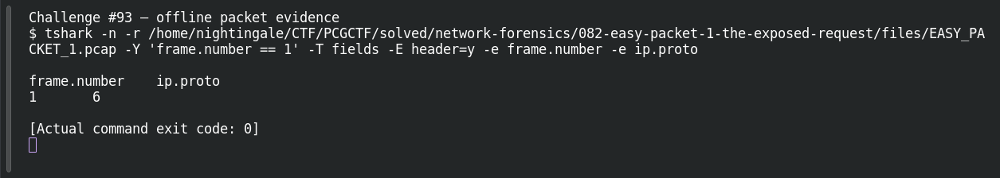

# EASY PACKET 1 #11 — Protocol 6

**Platform:** PCGCTF · **Challenge ID:** 93 · **Category:** Network Forensics · **Points:** 100

**Status:** Solved in the authenticated snapshot; field re-pulled from the capture for this writeup.

## The challenge

Name the transport protocol for IPv4 protocol number 6. The evidence is `EASY_PACKET_1.pcap`, the shared capture for this whole series.

## Solving it

```sh
tshark -nr EASY_PACKET_1.pcap -T fields -e ip.proto
```

```text
6
```

Protocol number 6 is TCP.

## Screenshot



## Flag

```text
pcgCTF{TCP}
```

## Reference

- [Original challenge description](../../solved/network-forensics/093-easy-packet-1-11-protocol-6/README.md)
