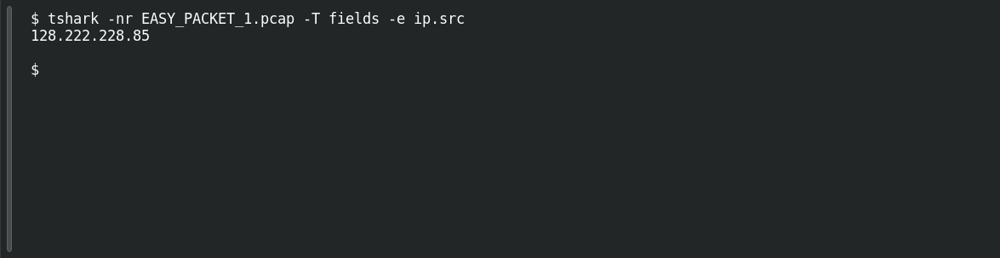

# EASY PACKET 1 #12 — Who Sent It?

**Platform:** PCGCTF · **Challenge ID:** 94 · **Category:** Network Forensics · **Points:** 100

**Status:** Solved in the authenticated snapshot; field re-pulled from the capture for this writeup.

## The challenge

Read the source IPv4 address. The evidence is `EASY_PACKET_1.pcap`, the shared capture for this whole series.

## Solving it

```sh
tshark -nr EASY_PACKET_1.pcap -T fields -e ip.src
```

```text
128.222.228.85
```

That's the sender.

## Screenshot

Fresh local reproduction using the command described above.



## Flag

```text
pcgCTF{128.222.228.85}
```

## Reference

- [Original challenge description](../../solved/network-forensics/094-easy-packet-1-12-who-sent-it/README.md)
