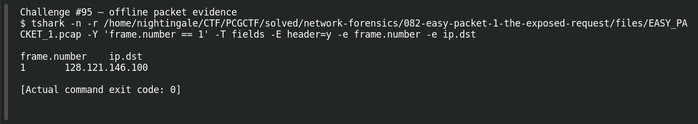

# EASY PACKET 1 #13 — Where Is It Going?

**Platform:** PCGCTF · **Challenge ID:** 95 · **Category:** Network Forensics · **Points:** 100

**Status:** Solved in the authenticated snapshot; field re-pulled from the capture for this writeup.

## The challenge

Read the destination IPv4 address. The evidence is `EASY_PACKET_1.pcap`, the shared capture for this whole series.

## Solving it

```sh
tshark -nr EASY_PACKET_1.pcap -T fields -e ip.dst
```

```text
128.121.146.100
```

That's the destination.

## Screenshot



## Flag

```text
pcgCTF{128.121.146.100}
```

## Reference

- [Original challenge description](../../solved/network-forensics/095-easy-packet-1-13-where-is-it-going/README.md)
