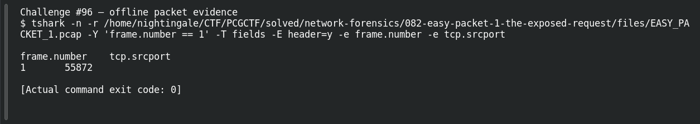

# EASY PACKET 1 #14 — Ephemeral Source

**Platform:** PCGCTF · **Challenge ID:** 96 · **Category:** Network Forensics · **Points:** 100

**Status:** Solved in the authenticated snapshot; field re-pulled from the capture for this writeup.

## The challenge

Find the client's TCP source port. The evidence is `EASY_PACKET_1.pcap`, the shared capture for this whole series.

## Solving it

```sh
tshark -nr EASY_PACKET_1.pcap -T fields -e tcp.srcport
```

```text
55872
```

A high ephemeral port, as you'd expect from the client side.

## Screenshot



## Flag

```text
pcgCTF{55872}
```

## Reference

- [Original challenge description](../../solved/network-forensics/096-easy-packet-1-14-ephemeral-source/README.md)
