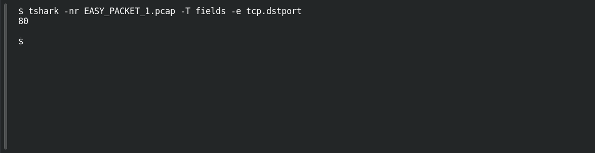

# EASY PACKET 1 #15 — Port 80

**Platform:** PCGCTF · **Challenge ID:** 97 · **Category:** Network Forensics · **Points:** 100

**Status:** Solved in the authenticated snapshot; field re-pulled from the capture for this writeup.

## The challenge

Find the destination TCP port. The evidence is `EASY_PACKET_1.pcap`, the shared capture for this whole series.

## Solving it

```sh
tshark -nr EASY_PACKET_1.pcap -T fields -e tcp.dstport
```

```text
80
```

Port 80 — plain HTTP.

## Screenshot

Fresh local reproduction using the command described above.



## Flag

```text
pcgCTF{80}
```

## Reference

- [Original challenge description](../../solved/network-forensics/097-easy-packet-1-15-port-80/README.md)
