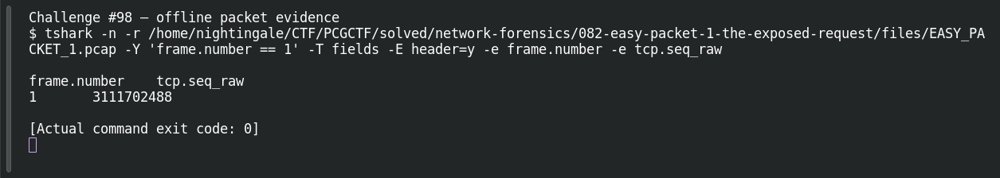

# EASY PACKET 1 #16  TCP Sequence Marker

| Item | Record |
|---|---|
| Platform | PCGCTF |
| Challenge ID | 98 |
| Category | Network Forensics |
| Points | 100 |
| Difficulty | Not separately recorded in the available inventory |
| Verification | Verified — marked solved in the original authenticated PCGCTF snapshot. The offline extraction below was reproduced for this draft; no fresh platform submission was made. |

## Challenge and objective

Recover the packet’s TCP sequence number.

The original description and prerequisite chain are preserved in [the challenge README](../../solved/network-forensics/098-easy-packet-1-16-tcp-sequence-marker/README.md). The supplied evidence is `EASY_PACKET_1.pcap`; related storyline questions reuse the same capture rather than providing another download.

## Initial analysis

Wireshark often displays relative sequence numbers to simplify a conversation. For a field-recovery challenge, I explicitly selected the raw on-wire value.

I kept the original capture intact and used offline packet analysis. The file’s SHA-256 is `e4735559a704fcd56ac790602e875a713f94a665af16ecd3ad49ea40ff394faa`. This identifies the exact evidence behind the frame references; no reconstructed program was executed and no request was sent to an address found inside the capture.

## Step-by-step solution

### 1. Select the field at the correct protocol layer

tcp.seq_raw is 3111702488. This is an unsigned 32-bit sequence value, identifying the first data byte represented by the segment; it is not a packet counter.

```sh
tshark -n \
  -r /home/nightingale/CTF/PCGCTF/solved/network-forensics/082-easy-packet-1-the-exposed-request/files/EASY_PACKET_1.pcap \
  -Y 'frame.number == 1' \
  -T fields -E header=y -e frame.number -e tcp.seq_raw
```

`-n` disables address/name resolution so that recorded numeric addresses stay visible. `-r` reads the existing capture, and `-Y` applies a display filter after decoding. `-T fields` outputs selected fields; each `-e` adds one named column, and `-E header=y` records the column names. `frame.number == 1` is appropriate because the independent capture count is one; it is not being used to prove that count. The selected `tcp.seq_raw`/`tcp.ack_raw` field is the on-wire value, avoiding relative sequence presentation.

**Actual reproduced output** (tab-separated; full lines are preserved in the linked TSV):

```text
frame.number	tcp.seq_raw
1	3111702488
```

### 2. Interpret the result

The saved candidate uses the raw value 3111702488. A GUI may display a small relative number instead, so a screenshot should show the raw-number field or the preference setting.

The request does not include a full TCP handshake, so relative sequence displays are a presentation convenience rather than new evidence. For a GUI screenshot, expand the TCP tree and show the raw number explicitly. [Wireshark’s TCP analysis guide](https://www.wireshark.org/docs/wsug_html_chunked/ChAdvTCPAnalysis.html) distinguishes analyzer calculations from the underlying sequence state.

## Captured screenshots and evidence

Captured on 2026-10-29 from actual terminal sessions or browser views. Captions distinguish new results, preserved records, source images and blockers. No platform acceptance is inferred from these images.

### Challenge #98 — offline packet evidence



Fresh execution of the draft’s field-specific TShark command.

Command/action actually executed:

```sh
tshark -n -r /home/nightingale/CTF/PCGCTF/solved/network-forensics/082-easy-packet-1-the-exposed-request/files/EASY_PACKET_1.pcap -Y 'frame.number == 1' -T fields -E header=y -e frame.number -e tcp.seq_raw
```

[Actual command transcript](../screenshots/capture-work/098-network.terminal.log) · [Execution record](../screenshots/capture-work/098-network.result.json). Notice the result fields discussed in the corresponding solution step; the transcript retains lines that extend beyond the screenshot viewport.

## Flag discovery and verification

Saved submission candidate:

```text
pcgCTF{3111702488}
```

Verified — marked solved in the original authenticated PCGCTF snapshot. The offline extraction below was reproduced for this draft; no fresh platform submission was made. The exact wrapper comes from the challenge’s `pcgCTF{...}` requirement; literal spaces, capitalization and separators are retained as recorded. The solved snapshot confirms challenge completion, not an independently captured acceptance response for this exact text.

## Conclusion and lesson

Check whether a network analyzer has transformed a field for readability before copying it into an exact-answer challenge. The artifact-backed answer and the platform acceptance state remain separate in this draft.

## Reproduction evidence and references

- [Original challenge description](../../solved/network-forensics/098-easy-packet-1-16-tcp-sequence-marker/README.md)
- [Actual TShark field output](../evidence/network/098-fields.tsv)
- [Commands, hashes and reproduction results](../evidence/network/reproduction.json)
- [TShark version](../evidence/network/tshark-version.txt)
- [TShark official manual](https://www.wireshark.org/docs/man-pages/tshark.html)

- [Earlier local solution and provenance](../../solved/network-forensics/098-easy-packet-1-16-tcp-sequence-marker/solution.md)
