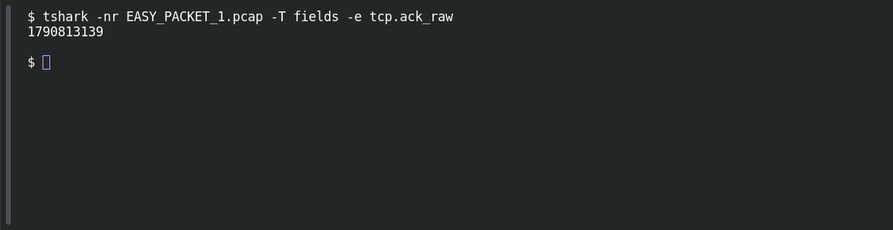

# EASY PACKET 1 #17 — TCP Acknowledgment Marker

**Platform:** PCGCTF · **Challenge ID:** 99 · **Category:** Network Forensics · **Points:** 100

**Status:** Solved in the authenticated snapshot; field re-pulled from the capture for this writeup.

**Evidence:** Packet 1 · TCP stream 0 · [EASY_PACKET_1.pcap](../../solved/network-forensics/082-easy-packet-1-the-exposed-request/files/EASY_PACKET_1.pcap).

## The challenge

Recover the raw TCP acknowledgment number. The evidence is `EASY_PACKET_1.pcap`, the shared capture for this whole series.

## Solving it

```sh
tshark -nr EASY_PACKET_1.pcap -T fields -e tcp.ack_raw
```

```text
1790813139
```

Again the raw field, not the relative ack.

## Screenshot

Fresh local reproduction using the command described above.



## Flag

```text
pcgCTF{1790813139}
```

## Reference

- [Original challenge description](../../solved/network-forensics/099-easy-packet-1-17-tcp-acknowledgment-marker/README.md)
