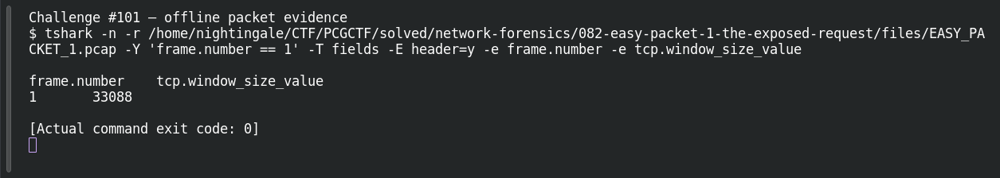

# EASY PACKET 1 #19 — TCP Window

**Platform:** PCGCTF · **Challenge ID:** 101 · **Category:** Network Forensics · **Points:** 100

**Status:** Solved in the authenticated snapshot; field re-pulled from the capture for this writeup.

## The challenge

Read the advertised TCP receive window. The evidence is `EASY_PACKET_1.pcap`, the shared capture for this whole series.

## Solving it

```sh
tshark -nr EASY_PACKET_1.pcap -T fields -e tcp.window_size_value
```

```text
33088
```

That's the window value as it appears on the wire (no scaling applied).

## Screenshot



## Flag

```text
pcgCTF{33088}
```

## Reference

- [Original challenge description](../../solved/network-forensics/101-easy-packet-1-19-tcp-window/README.md)
