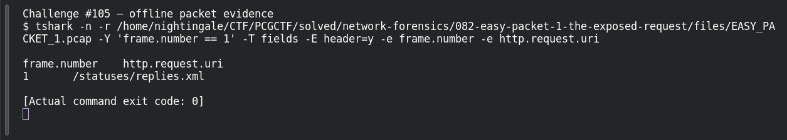

# EASY PACKET 1 #23 — The Requested Path

**Platform:** PCGCTF · **Challenge ID:** 105 · **Category:** Network Forensics · **Points:** 100

**Status:** Solved in the authenticated snapshot; field re-pulled from the capture for this writeup.

## The challenge

Recover the requested HTTP path. The evidence is `EASY_PACKET_1.pcap`, the shared capture for this whole series.

## Solving it

```sh
tshark -nr EASY_PACKET_1.pcap -Y http -T fields -e http.request.uri
```

```text
/statuses/replies.xml
```


## Screenshot



## Flag

```text
pcgCTF{/statuses/replies.xml}
```

## Reference

- [Original challenge description](../../solved/network-forensics/105-easy-packet-1-23-the-requested-path/README.md)
