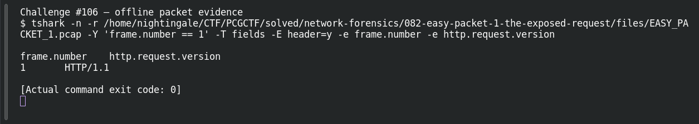

# EASY PACKET 1 #24 — HTTP/1.1

**Platform:** PCGCTF · **Challenge ID:** 106 · **Category:** Network Forensics · **Points:** 100

**Status:** Solved in the authenticated snapshot; field re-pulled from the capture for this writeup.

## The challenge

Read the HTTP version from the request line. The evidence is `EASY_PACKET_1.pcap`, the shared capture for this whole series.

## Solving it

```sh
tshark -nr EASY_PACKET_1.pcap -Y http -T fields -e http.request.version
```

```text
HTTP/1.1
```


## Screenshot



## Flag

```text
pcgCTF{HTTP/1.1}
```

## Reference

- [Original challenge description](../../solved/network-forensics/106-easy-packet-1-24-http-1-1/README.md)
