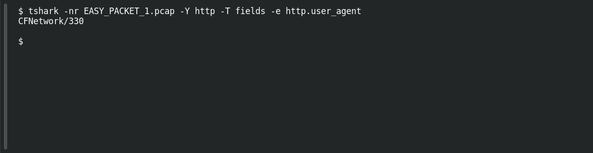

# EASY PACKET 1 #26 — Identify the Client

**Platform:** PCGCTF · **Challenge ID:** 108 · **Category:** Network Forensics · **Points:** 100

**Status:** Solved in the authenticated snapshot; field re-pulled from the capture for this writeup.

## The challenge

Read the User-Agent. The evidence is `EASY_PACKET_1.pcap`, the shared capture for this whole series.

## Solving it

```sh
tshark -nr EASY_PACKET_1.pcap -Y http -T fields -e http.user_agent
```

```text
CFNetwork/330
```

An old iOS/macOS CFNetwork client — consistent with the Twitter API request.

## Screenshot

Fresh local reproduction using the command described above.



## Flag

```text
pcgCTF{CFNetwork/330}
```

## Reference

- [Original challenge description](../../solved/network-forensics/108-easy-packet-1-26-identify-the-client/README.md)
