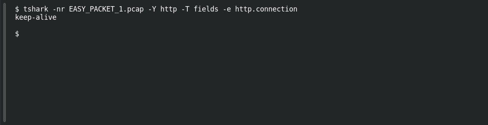

# EASY PACKET 1 #27 — Keep the Connection

**Platform:** PCGCTF · **Challenge ID:** 109 · **Category:** Network Forensics · **Points:** 100

**Status:** Solved in the authenticated snapshot; field re-pulled from the capture for this writeup.

## The challenge

Recover the HTTP Connection header value. The evidence is `EASY_PACKET_1.pcap`, the shared capture for this whole series.

## Solving it

```sh
tshark -nr EASY_PACKET_1.pcap -Y http -T fields -e http.connection
```

```text
keep-alive
```

## Screenshot

Fresh local reproduction using the command described above.



## Flag

```text
pcgCTF{keep-alive}
```

## Reference

- [Original challenge description](../../solved/network-forensics/109-easy-packet-1-27-keep-the-connection/README.md)
