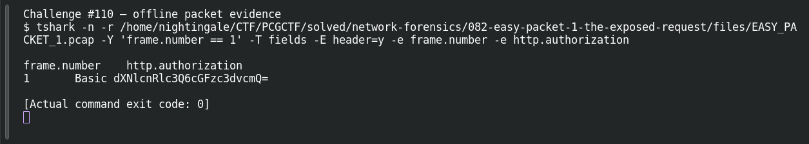

# EASY PACKET 1 #28 — Basic Authentication

**Platform:** PCGCTF · **Challenge ID:** 110 · **Category:** Network Forensics · **Points:** 100

**Status:** Solved in the authenticated snapshot; field re-pulled from the capture for this writeup.

## The challenge

Identify the HTTP Authorization scheme. The evidence is `EASY_PACKET_1.pcap`, the shared capture for this whole series.

## Solving it

```sh
tshark -nr EASY_PACKET_1.pcap -Y http -T fields -e http.authorization
```

```text
Basic dXNlcnRlc3Q6cGFzc3dvcmQ=
```

The scheme is the first token — Basic. (The token itself decodes to credentials; that's challenge #01's job, not this one's.)

## Screenshot



## Flag

```text
pcgCTF{Basic}
```

## Reference

- [Original challenge description](../../solved/network-forensics/110-easy-packet-1-28-basic-authentication/README.md)
