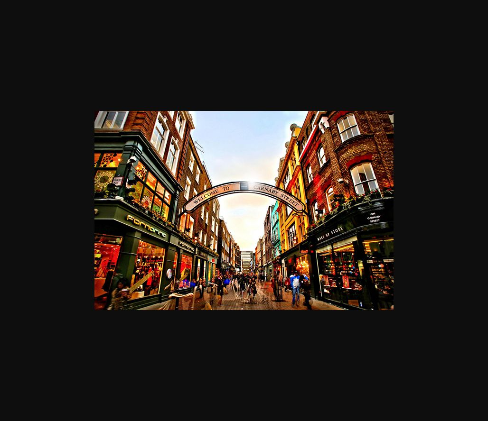

# Street-Level Clue

**Platform:** PCGCTF · **Challenge ID:** 239 · **Category:** OSINT / IMINT · **Points:** 100

**Difficulty:** Not recorded in the available platform metadata.

**Verification status:** Verified — solved in the last PCGCTF snapshot. Local evidence independently reproduced; exact historical platform submission is not newly tested.

## Challenge and objective

Identify the street in the supplied photograph using visible signage.

Original description: [saved challenge description](</home/nightingale/CTF/PCGCTF/solved/osint-imint/239-street-level-clue/README.md>). Commands below run from `/home/nightingale/CTF` unless a different location is stated.

## Initial analysis

The most useful clue is already legible in the source image: an overhead arch names the street. Secondary storefront text supports the reading. This is a direct visual identification, so reverse-image searching and guessed GPS coordinates add little and can introduce unrelated locations.

## Step-by-step solution

### 1. Inspect the original photograph at readable size

The original file preserves the full-resolution lettering. Read the arch before interpreting the architectural style or brand names. This action was reproduced with the available image viewer.

```sh
Open PCGCTF/solved/osint-imint/239-street-level-clue/files/task2_1602089234031.jpg in an image viewer. Zoom to the overhead arch.
```

**Recorded output / observation:**

```text
WELCOME TO CARNABY STREET
Secondary sign: ON CARNABY STREET
```

The exact requested street is Carnaby Street. The source photo itself is stronger evidence than a search result that happens to contain a similar shopping street.

## Visual evidence


The overhead arch directly names Carnaby Street; box that lettering in the publication version.

## Captured screenshots and evidence

Captured on 2026-10-29 from actual terminal sessions or browser views. Captions distinguish new results, preserved records, source images and blockers. No platform acceptance is inferred from these images.

### 239-actual-browser-image.png



Original supplied image displayed in the browser; identification context only, not an independent acceptance record.

## Flag discovery and verification

Saved result / candidate:

```text
pcgCTF{Carnaby Street}
```

Local evidence independently reproduced; exact historical platform submission is not newly tested.

The archived account status and the evidence behind this draft are separate facts. No new PCGCTF acceptance is claimed. Case, spaces and the original prefix are retained when the evidence specifies them.

## Remaining review tasks

- The available command results are captured below. Preserve a real acceptance record if a later platform verification is performed.

## What this challenge taught me

Start with explicit, readable labels before making broad geographic inferences. A short geolocation writeup can still show its decisive evidence and preserve the exact answer spelling.

## Evidence and attribution

- [Original challenge and attachments](</home/nightingale/CTF/PCGCTF/solved/osint-imint/239-street-level-clue/README.md>)
- [Earlier solution / teammate provenance](</home/nightingale/CTF/PCGCTF/solved/osint-imint/239-street-level-clue/solution.md>)
