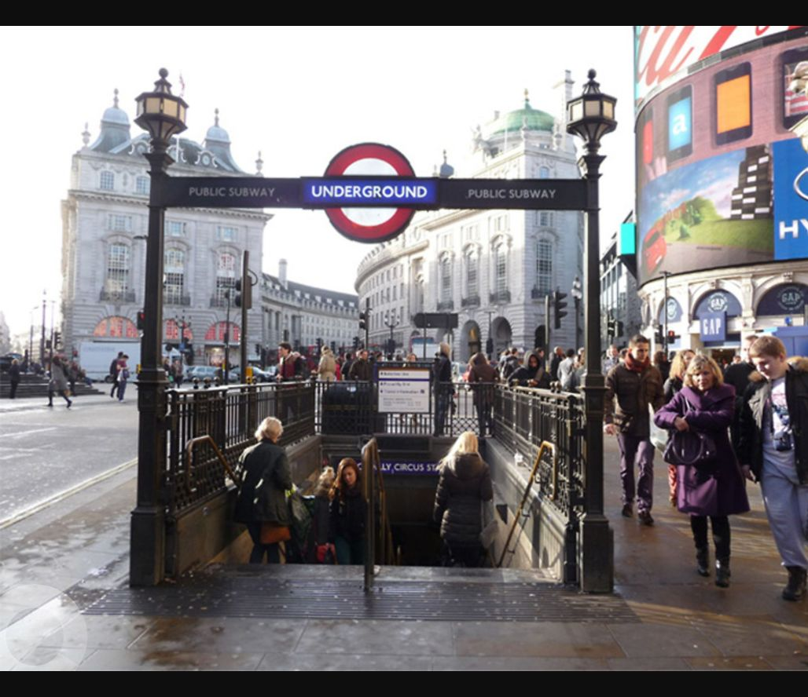

# Tube Station — Opening Year

**Platform:** PCGCTF · **Challenge ID:** 242 · **Category:** OSINT / IMINT · **Points:** 100

**Difficulty:** Not recorded in the available platform metadata.

**Verification status:** Verified — solved in the last PCGCTF snapshot. Local evidence independently reproduced; exact historical platform submission is not newly tested.

## Challenge and objective

Determine the opening year of the station identified as Piccadilly Circus.

Original description: [saved challenge description](</home/nightingale/CTF/PCGCTF/solved/osint-imint/242-tube-station-opening-year/README.md>). Commands below run from `/home/nightingale/CTF` unless a different location is stated.

## Initial analysis

A station can have several plausible dates: initial opening, an additional line, a rebuilt ticket hall or a later entrance. The prompt asks when the station opened, so the initial operation date is the relevant one. Both lines arrived in 1906, while the substantial modernization in 1928 is a separate event.

## Step-by-step solution

### 1. Carry forward the image identification

Use the shared source photograph to establish Piccadilly Circus before researching dates. This prevents a correct date for the wrong station.

```sh
/home/nightingale/CTF/PCGCTF/solved/osint-imint/240-tube-station-city/files/task3_1602089306375.jpg
```

**Recorded output / observation:**

```text
Station identified visually: Piccadilly Circus
```

The station name now provides a precise historical search target.

### 2. Check the original opening history

These are authoritative records for the station rather than generic travel snippets. The museum gives the Bakerloo opening as 10 March 1906 and the Piccadilly line opening as 15 December 1906; Historic England independently places the initial opening in March 1906.

```sh
Open the London Transport Museum Piccadilly Circus tour booklet and Historic England listing 1226877.
```

**Recorded output / observation:**

```text
Initial opening: 10 March 1906
Additional line: 15 December 1906
Requested year: 1906
```

The two 1906 dates agree on the requested year. The later 1928 redevelopment is not the answer.

## Visual evidence


Shared image used to fix the station identity before date research.

## Captured screenshots and evidence

Captured on 2026-10-29 from actual terminal sessions or browser views. Captions distinguish new results, preserved records, source images and blockers. No platform acceptance is inferred from these images.

### 242-actual-browser-image.png



Original supplied image displayed in the browser; identification context only, not an independent acceptance record.

## Flag discovery and verification

Saved result / candidate:

```text
pcgCTF{1906}
```

Local evidence independently reproduced; exact historical platform submission is not newly tested.

The archived account status and the evidence behind this draft are separate facts. No new PCGCTF acceptance is claimed. Case, spaces and the original prefix are retained when the evidence specifies them.

Sources: [London Transport Museum booklet](https://www.ltmuseum.co.uk/sites/default/files/2024-11/London%20Transport%20Museum%20Hidden%20London%20Piccadilly%20Circus%20Tour.pdf), [Historic England listing](https://historicengland.org.uk/listing/the-list/list-entry/1226877).

## Remaining review tasks

- The available command results are captured below. Preserve a real acceptance record if a later platform verification is performed.

## What this challenge taught me

Historical geolocation questions require matching the event as well as the place. Distinguish initial opening from rebuilds and extensions.

## Evidence and attribution

- [Original challenge and attachments](</home/nightingale/CTF/PCGCTF/solved/osint-imint/242-tube-station-opening-year/README.md>)
