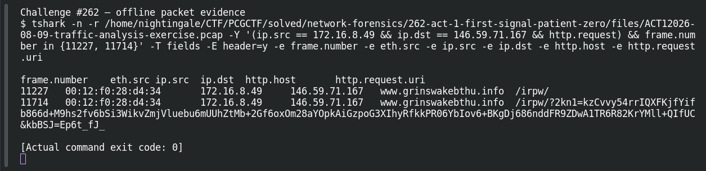

# ACT 1 — First Signal: Patient Zero

**Platform:** PCGCTF · **Challenge ID:** 262 · **Category:** Network Forensics · **Points:** 100

**Status:** Solved in the authenticated snapshot; reproduced from the capture (`ACT1 2026-08-09-traffic-analysis-exercise.pcap`, the shared Act 1 capture).

## The challenge

Find the internal host making the suspicious FormBook-pattern connections.

## Solving it

Rather than chasing the noisiest host, I looked for the repeating request pattern — one internal client hitting the same odd infrastructure. Filtering HTTP requests to it:

```sh
tshark -nr act1.pcap -Y 'http.request && ip.dst==146.59.71.167' \
  -T fields -e ip.src -e http.host -e http.request.uri
```

```text
172.16.8.49  www.grinswakebthu.info  /irpw/
172.16.8.49  www.grinswakebthu.info  /irpw/?2kn1=...&kbBSJ=...
```

One host — 172.16.8.49 — repeatedly POSTing to `/irpw/` and then sending a GET with encoded check-in parameters. That's the victim.

## Screenshot



## Flag

```text
pcgCTF{172.16.8.49}
```

## Takeaway

Pick out the host with the *recurring* connection to one piece of infrastructure, and keep an example packet for the association — don't brand every external address a host touches as malicious.

## Reference

- [Original challenge description](../../solved/network-forensics/262-act-1-first-signal-patient-zero/README.md)
