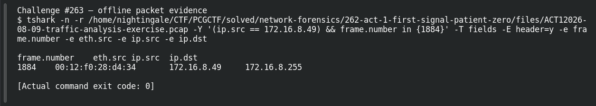

# ACT 1 — First Signal: Hardware Fingerprint

**Platform:** PCGCTF · **Challenge ID:** 263 · **Category:** Network Forensics · **Points:** 100

**Status:** Solved in the authenticated snapshot; reproduced from the Act 1 capture.

## The challenge

Tie the victim IP (172.16.8.49) to its Ethernet MAC address.

## Solving it

I wanted the MAC and IP from the *same* frame — a local broadcast the host sent is perfect, since the source MAC is definitely the workstation's (not a router's):

```sh
tshark -nr act1.pcap -Y 'ip.src==172.16.8.49' -T fields -e eth.src -e ip.src -e ip.dst
```

```text
00:12:f0:28:d4:34  172.16.8.49  172.16.8.255
```

A broadcast to `.255`, so the source MAC `00:12:f0:28:d4:34` is the victim's hardware address.

## Screenshot



## Flag

```text
pcgCTF{00:12:f0:28:d4:34}
```

## Takeaway

Read the source IP and source MAC from one frame — don't stitch values together from unrelated packets, and don't mistake a destination MAC for the host's.

## Reference

- [Original challenge description](../../solved/network-forensics/263-act-1-first-signal-hardware-fingerprint/README.md)
