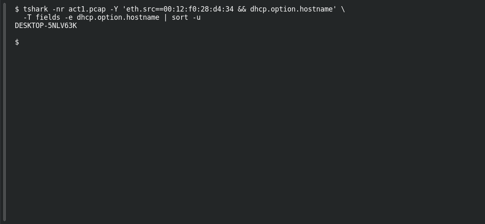

# ACT 1 — First Signal: Name the Host

**Platform:** PCGCTF · **Challenge ID:** 264 · **Category:** Network Forensics · **Points:** 100

**Status:** Solved in the authenticated snapshot; reproduced from the Act 1 capture.

## The challenge

Recover the victim's Windows hostname.

## Solving it

Use [the shared capture](../../solved/network-forensics/262-act-1-first-signal-patient-zero/files/ACT12026-08-09-traffic-analysis-exercise.pcap) as `act1.pcap` for the commands below.

Windows clients announce their hostname in DHCP option 12, so I pulled that from the victim's frames:

```sh
tshark -nr act1.pcap -Y 'eth.src==00:12:f0:28:d4:34 && dhcp.option.hostname' \
  -T fields -e dhcp.option.hostname | sort -u
```

```text
DESKTOP-5NLV63K
```

## Screenshot

Fresh local reproduction using the command described above.



## Flag

```text
pcgCTF{DESKTOP-5NLV63K}
```

## Takeaway

DHCP, NBNS and Kerberos all leak a host's name — DHCP option 12 is usually the cleanest.

## Reference

- [Original challenge description](../../solved/network-forensics/264-act-1-first-signal-name-the-host/README.md)
